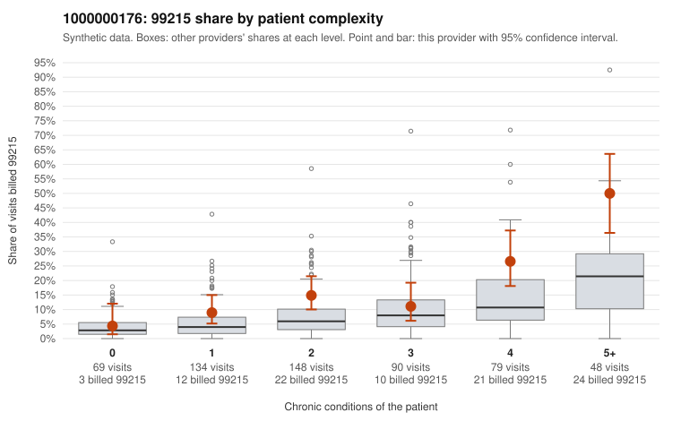

# 1000000176: 1000000176: too few returned records to judge

**Leaning (advisory):** Inconclusive

## Why

1000000176 billed 99215 on 16.2% of 568 claims against an expected 6.8% given patient complexity (risk-adjusted score 3.40; plain z-score vs peers 1.28). 16% of this provider's 99215 claims were on patients with 0 or 1 chronic conditions. Records came back for 30 claims. Of 4 documented 99215 claims, 0 (0%) were documented below the billed level, against 30% for the comparison providers. Note checks on 30 returned notes (share showing each sign): problems 7%, late 0%, unsigned 0%, data 3%. No audit trail was received. 1 of 21 notes claiming moderate-or-higher data reviewed had no lab or test line on the claim. The evidence does not support a call either way yet. Examples: C0086596: billed 99213; documented MDM level straightforward, minutes not recorded. C0086709: billed 99213; documented MDM level straightforward, minutes not recorded. C0086276: billed 99215, patient aged 42 with 1 chronic condition(s) (hyperlipidemia). C0086290: billed 99215, patient aged 27 with 0 chronic condition(s).

## Evidence chart

## Cited claims

`C0086596`, `C0086709`, `C0086276`, `C0086290`

## Suggested next steps

- 30 charts came back but do not settle it: request a targeted sample of 99215 charts, starting with C0086596, C0086709, C0086276.
- Re-check after the targeted charts arrive; do not call upcoding or a sicker panel on this evidence alone.

---
Citations checked: 4/4 valid. Synthetic data. The leaning is advisory; the flag comes from the statistical screen, and no clinical documentation is available beyond the sampled records-review facts shown in the packet.
