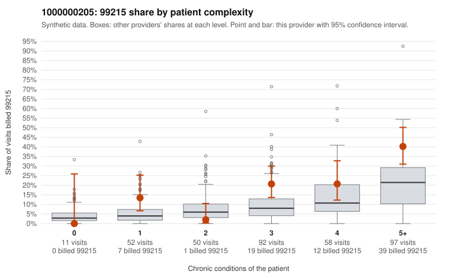

# 1000000205: 1000000205: documented 99215 claims mostly support the level billed (22% below)

**Leaning (advisory):** Pattern consistent with a high-acuity panel

## Why

1000000205 billed 99215 on 21.7% of 360 claims against an expected 9.8% given patient complexity (risk-adjusted score 2.86; plain z-score vs peers 2.08). 9% of this provider's 99215 claims were on patients with 0 or 1 chronic conditions. Records came back for 30 claims. Of 9 documented 99215 claims, 2 (22%) were documented below the billed level, against 30% for the comparison providers. Note checks on 30 returned notes (share showing each sign): problems 13%, late 10%, unsigned 0%, data 7%. No audit trail was received. 4 of 20 notes claiming moderate-or-higher data reviewed had no lab or test line on the claim. This pattern is consistent with a high-acuity panel. The sampled documentation supports the billed level. Examples: C0100506: billed 99215; documented MDM level high, 49 minutes. C0100530: billed 99215; documented MDM level high, 46 minutes. C0100578: billed 99215; documented MDM level high, minutes not recorded. C0100279: billed 99215, patient aged 68 with 4 chronic condition(s) (depression;asthma;osteoarthritis;chronic kidney disease). C0100293: billed 99215, patient aged 70 with 4 chronic condition(s) (hyperlipidemia;heart failure;osteoarthritis;chronic kidney disease).

## Evidence chart

## Cited claims

`C0100506`, `C0100530`, `C0100578`, `C0100279`, `C0100293`

## Suggested next steps

- Do not pursue recovery on this evidence: 30 charts came back and they support the level billed (2 of 9 documented 99215 claims below the billed level).
- Revisit if the 99215 share keeps rising against peers or a larger sample shows unsupported claims.

---
Citations checked: 5/5 valid. Synthetic data. The leaning is advisory; the flag comes from the statistical screen, and no clinical documentation is available beyond the sampled records-review facts shown in the packet.
