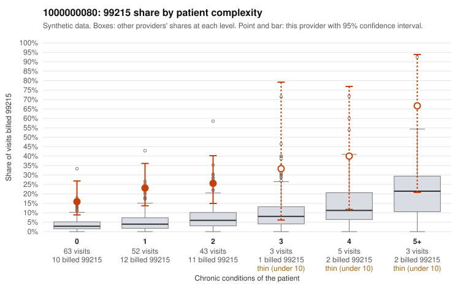

# Payment Integrity dossier: 1000000080

> Draft for human review. Statistical and records-sample evidence only; not a finding. Compliance or legal review is needed before any provider contact, notice or recoupment.

## Provider overview

| | |
|---|---|
| Specialty / state | Family Practice, GA (synthetic) |
| Claims / patients | 169 / 91 |
| Billed mix (99211 to 99215) | 0 / 0 / 21 / 110 / 38 |
| 99215 share | 22.5% |
| Expected 99215 share given patient complexity | 4.3% |
| Screen scores | z vs peers 2.20; risk-adjusted 4.40; flagged by eb_ratio_t |

## Case summary (advisory)

**1000000080: 1 of 8 documented 99215 claims (12%) are documented below the billed level**

Leaning: pattern consistent with upcoding. Citations checked: 4/4 valid.

1000000080 billed 99215 on 22.5% of 169 claims against an expected 4.3% given patient complexity (risk-adjusted score 4.40; plain z-score vs peers 2.20). 58% of this provider's 99215 claims were on patients with 0 or 1 chronic conditions. Records came back for 30 claims. Of 8 documented 99215 claims, 1 (12%) were documented below the billed level, against 30% for the comparison providers. Note checks on 30 returned notes (share showing each sign): problems 40%, late 17%, unsigned 0%, data 3%, bulk created 0%, paste heavy 0%. 3 of 23 notes claiming moderate-or-higher data reviewed had no lab or test line on the claim. This pattern is consistent with upcoding. It is a reason to review the records, not a finding. Examples: C0035094: billed 99215, patient aged 45 with 0 chronic condition(s); documented MDM level moderate, minutes not recorded. C0034948: billed 99215, patient aged 63 with 1 chronic condition(s) (osteoarthritis). C0034957: billed 99215, patient aged 31 with 1 chronic condition(s) (hyperlipidemia). C0034966: billed 99215, patient aged 57 with 1 chronic condition(s) (chronic kidney disease).

## Evidence chart

## Records-review sample so far

Documentation is on file for 30 claims (18% of this provider's claims).

| Billed | Documented | Documentation below billed level | Rate | All-provider rate |
|---|---|---|---|---|
| 99213 | 7 | 0 | 0.0% | 5.1% |
| 99214 | 15 | 0 | 0.0% | 7.5% |
| 99215 | 8 | 1 | 12.5% | 30.3% |

## Recommended next steps for Payment Integrity

1. Request records for the sampled claims in `record_request_list.csv` (25 claims across 99215).
2. Review the records against E/M documentation rules and record the supported level for each claim.
3. Run the overpayment estimator on the reviewed sample (`sampling_plan.md` explains how).
4. Notice, appeal rights, recoupment, education or corrective action, and any referral are decisions for the PI team, compliance and counsel. Nothing here drafts those.

Suggested follow-ups from the case summary:

- Request the full charts for C0035094, C0034948, C0034957 and have a certified coder re-score each against the current E/M rules (medical decision making or total time).
- If the re-scoring confirms the pattern, review the random sample in the recovery packet's sampling plan before any overpayment estimate; do not extrapolate from a targeted sample.
- Look at the notes themselves: 40% address fewer problems than their level implies and 17% were signed late; request the audit trail for C0035094, C0034948, C0034957.

## Limits

- Synthetic data; no real claims or providers.
- The leaning is advisory. The flag comes from the statistical screen; the summary explains it.
- The records-review sample is partial and was simulated for this project.
- Allowed amounts are GA Family Practice averages from a public CMS file, not this provider's actual payments.
