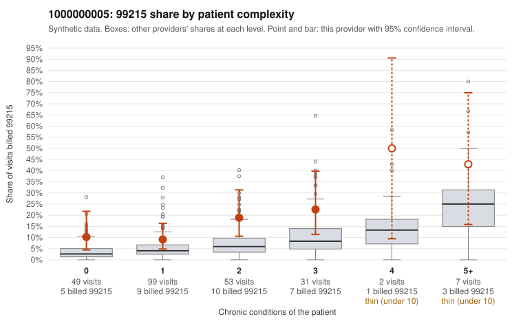

# 1000000005: 1000000005: 7 of 19 documented 99214 and 99215 claims (37%) are documented below the billed level

**Leaning (advisory):** Pattern consistent with upcoding

## Why

1000000005 billed 99215 on 14.5% of 241 claims against an expected 5.1% given patient complexity (risk-adjusted score 2.50; plain z-score vs peers 1.31). 40% of this provider's 99215 claims were on patients with 0 or 1 chronic conditions. Records came back for 30 claims. Of 3 documented 99215 claims, 2 (67%) were documented below the billed level, against 33% for the comparison providers. Note checks on 30 returned notes (share showing each sign): problems 33%, late 0%, unsigned 0%, data 0%. No audit trail was received. 0 of 14 notes claiming moderate-or-higher data reviewed had no lab or test line on the claim. This pattern is consistent with upcoding. It is a reason to review the records, not a finding. Examples: C0002187: billed 99215, patient aged 64 with 1 chronic condition(s) (asthma); documented MDM level moderate, 21 minutes. C0002251: billed 99215, patient aged 67 with 0 chronic condition(s); documented MDM level moderate, 36 minutes. C0002084: billed 99215, patient aged 21 with 0 chronic condition(s). C0002110: billed 99215, patient aged 42 with 0 chronic condition(s). C0002122: billed 99215, patient aged 73 with 1 chronic condition(s) (obesity); documented MDM level high, 46 minutes.

## Evidence chart

## Cited claims

`C0002187`, `C0002251`, `C0002084`, `C0002110`, `C0002122`

## Suggested next steps

- Request the full charts for C0002187, C0002251, C0002084 and have a certified coder re-score each against the current E/M rules (medical decision making or total time).
- If the re-scoring confirms the pattern, review the random sample in the recovery packet's sampling plan before any overpayment estimate; do not extrapolate from a targeted sample.
- Look at the notes themselves: 33% address fewer problems than their level implies and 0% were signed late; request the audit trail for C0002187, C0002251, C0002084.

---
Citations checked: 5/5 valid. Synthetic data. The leaning is advisory; the flag comes from the statistical screen, and no clinical documentation is available beyond the sampled records-review facts shown in the packet.
