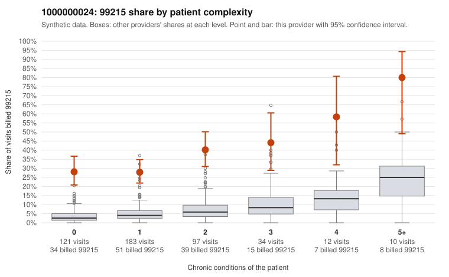

# 1000000024: 1000000024: too few returned records to judge

**Leaning (advisory):** Inconclusive

## Why

1000000024 billed 99215 on 33.7% of 457 claims against an expected 4.8% given patient complexity (risk-adjusted score 11.18; plain z-score vs peers 4.67). 55% of this provider's 99215 claims were on patients with 0 or 1 chronic conditions. Records came back for 25 claims. Of 10 documented 99215 claims, 5 (50%) were documented below the billed level, against 33% for the comparison providers. Note checks on 25 returned notes (share showing each sign): problems 24%, late 8%, unsigned 0%, data 4%. No audit trail was received. 1 of 19 notes claiming moderate-or-higher data reviewed had no lab or test line on the claim. The evidence does not support a call either way yet. Examples: C0014843: billed 99215; documented MDM level moderate, 36 minutes. C0014883: billed 99215, patient aged 18 with 1 chronic condition(s) (osteoarthritis); documented MDM level moderate, 33 minutes. C0014699: billed 99215, patient aged 37 with 1 chronic condition(s) (type 2 diabetes). C0014700: billed 99215, patient aged 31 with 1 chronic condition(s) (chronic kidney disease).

## Evidence chart

## Cited claims

`C0014843`, `C0014883`, `C0014699`, `C0014700`

## Suggested next steps

- 25 charts came back but do not settle it: request a targeted sample of 99215 charts, starting with C0014843, C0014883, C0014699.
- Re-check after the targeted charts arrive; do not call upcoding or a sicker panel on this evidence alone.

---
Citations checked: 4/4 valid. Synthetic data. The leaning is advisory; the flag comes from the statistical screen, and no clinical documentation is available beyond the sampled records-review facts shown in the packet.
