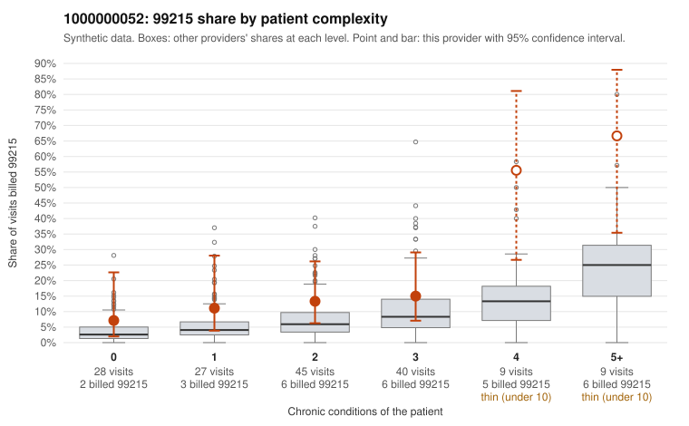

# 1000000052: 1000000052: too few returned records to judge

**Leaning (advisory):** Inconclusive

## Why

1000000052 billed 99215 on 17.7% of 158 claims against an expected 6.4% given patient complexity (risk-adjusted score 2.18; plain z-score vs peers 1.87). 18% of this provider's 99215 claims were on patients with 0 or 1 chronic conditions. Records came back for 28 claims. Of 5 documented 99215 claims, 1 (20%) were documented below the billed level, against 33% for the comparison providers. Note checks on 28 returned notes (share showing each sign): problems 11%, late 4%, unsigned 0%, data 11%. No audit trail was received. 3 of 16 notes claiming moderate-or-higher data reviewed had no lab or test line on the claim. The evidence does not support a call either way yet. Examples: C0032880: billed 99215, patient aged 80 with 5 chronic condition(s) (hypothyroidism;type 2 diabetes;depression;atrial fibrillation;heart failure); documented MDM level moderate, 38 minutes. C0032718: billed 99215, patient aged 67 with 1 chronic condition(s) (depression). C0032757: billed 99215, patient aged 55 with 0 chronic condition(s).

## Evidence chart

## Cited claims

`C0032880`, `C0032718`, `C0032757`

## Suggested next steps

- 28 charts came back but do not settle it: request a targeted sample of 99215 charts, starting with C0032880, C0032718, C0032757.
- Re-check after the targeted charts arrive; do not call upcoding or a sicker panel on this evidence alone.

---
Citations checked: 3/3 valid. Synthetic data. The leaning is advisory; the flag comes from the statistical screen, and no clinical documentation is available beyond the sampled records-review facts shown in the packet.
