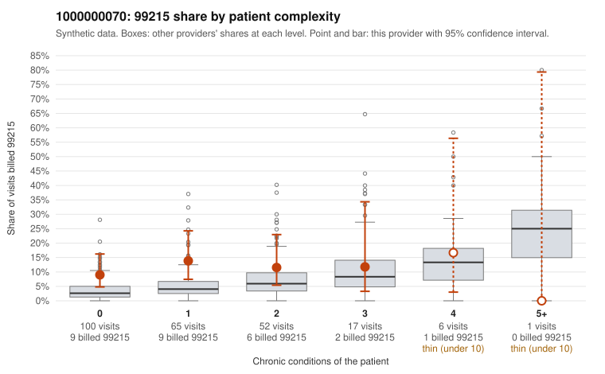

# 1000000070: 1000000070: too few returned records to judge

**Leaning (advisory):** Inconclusive

## Why

1000000070 billed 99215 on 11.2% of 241 claims against an expected 4.4% given patient complexity (risk-adjusted score 1.91; plain z-score vs peers 0.73). 67% of this provider's 99215 claims were on patients with 0 or 1 chronic conditions. Records came back for 30 claims. Of 4 documented 99215 claims, 0 (0%) were documented below the billed level, against 33% for the comparison providers. Note checks on 30 returned notes (share showing each sign): problems 30%, late 13%, unsigned 0%, data 13%. No audit trail was received. 4 of 15 notes claiming moderate-or-higher data reviewed had no lab or test line on the claim. The evidence does not support a call either way yet. Examples: C0040837: billed 99214; documented MDM level low, minutes not recorded. C0040716: billed 99215, patient aged 50 with 0 chronic condition(s). C0040722: billed 99215, patient aged 33 with 0 chronic condition(s).

## Evidence chart

## Cited claims

`C0040837`, `C0040716`, `C0040722`

## Suggested next steps

- 30 charts came back but do not settle it: request a targeted sample of 99215 charts, starting with C0040837, C0040716, C0040722.
- Re-check after the targeted charts arrive; do not call upcoding or a sicker panel on this evidence alone.

---
Citations checked: 3/3 valid. Synthetic data. The leaning is advisory; the flag comes from the statistical screen, and no clinical documentation is available beyond the sampled records-review facts shown in the packet.
