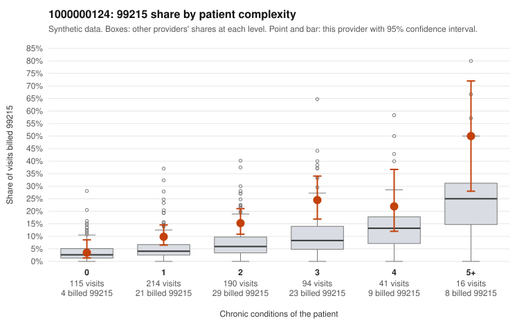

# 1000000124: 1000000124: documented 99215 claims mostly support the level billed (17% below)

**Leaning (advisory):** Pattern consistent with a high-acuity panel

## Why

1000000124 billed 99215 on 14.0% of 670 claims against an expected 5.6% given patient complexity (risk-adjusted score 3.64; plain z-score vs peers 1.22). 27% of this provider's 99215 claims were on patients with 0 or 1 chronic conditions. Records came back for 44 claims. Of 18 documented 99215 claims, 3 (17%) were documented below the billed level, against 33% for the comparison providers. Note checks on 44 returned notes (share showing each sign): problems 20%, late 4%, unsigned 0%, data 2%. No audit trail was received. 4 of 31 notes claiming moderate-or-higher data reviewed had no lab or test line on the claim. This pattern is consistent with a high-acuity panel. The sampled documentation supports the billed level. Examples: C0068952: billed 99215, patient aged 54 with 1 chronic condition(s) (obesity); documented MDM level high, 54 minutes. C0069060: billed 99215; documented MDM level high, minutes not recorded. C0069093: billed 99215; documented MDM level high, 44 minutes. C0068565: billed 99215, patient aged 18 with 4 chronic condition(s) (type 2 diabetes;obesity;hypertension;asthma). C0068610: billed 99215, patient aged 81 with 5 chronic condition(s) (hypothyroidism;type 2 diabetes;obesity;hypertension;COPD).

## Evidence chart

## Cited claims

`C0068952`, `C0069060`, `C0069093`, `C0068565`, `C0068610`

## Suggested next steps

- Do not pursue recovery on this evidence: 44 charts came back and they support the level billed (3 of 18 documented 99215 claims below the billed level).
- Revisit if the 99215 share keeps rising against peers or a larger sample shows unsupported claims.

---
Citations checked: 5/5 valid. Synthetic data. The leaning is advisory; the flag comes from the statistical screen, and no clinical documentation is available beyond the sampled records-review facts shown in the packet.
