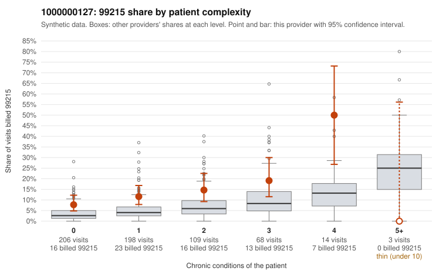

# 1000000127: Provider 1000000127 bills 99215 well above risk-adjusted expectation, with about half on low-complexity patients, but the few returned charts all support the billed level and carry signs of possible note inflation, so the picture is unresolved.

**Leaning (advisory):** Inconclusive

## Why

1000000127 billed 99215 on 12.5% of 598 claims against an expected 4.6% given patient complexity (risk-adjusted score 3.55; plain z-score vs peers 0.96). 52% of this provider's 99215 claims were on patients with 0 or 1 chronic conditions. Records came back for 30 claims. Of 7 documented 99215 claims, 0 (0%) were documented below the billed level, against 33% for the comparison providers. Note checks on 30 returned notes (share showing each sign): problems 30%, late 0%, unsigned 0%, data 17%. No audit trail was received. 5 of 17 notes claiming moderate-or-higher data reviewed had no lab or test line on the claim. The billing side looks like upcoding rather than a sicker panel: the 99215 share runs above the all-provider rate in nearly every complexity band, and the sampled low-complexity 99215s are often single routine diagnoses (for example C0070078 and C0070177 for J06.9, C0070586 for M54.50, C0070377 for Z09). Against that, all 7 documented 99215 claims were supported at high MDM, which would normally point toward legitimate complexity. But 7 charts out of 30 returned (5% of claims) is too thin to settle the question, and the notes show possible inflation. C0070123, an R21 visit for a patient with no chronic conditions, is documented as high MDM with no time recorded. Repeated times and data-reviewed claims without matching lab or test lines (for example C0070142, C0070188, C0070474) are weak signs that notes may be templated to match the billed level rather than what happened. A reviewer should first request a larger, targeted chart pull focused on the low-complexity 99215s in the sample, plus the EHR audit trail. The aim is to check whether high-MDM elements, data review and visit times are genuinely patient-specific or cloned. Examples: C0070049: billed 99215, patient aged 55 with 0 chronic condition(s). C0070078: billed 99215, patient aged 47 with 0 chronic condition(s).

## Evidence chart

## Cited claims

`C0070049`, `C0070078`

## Suggested next steps

- 30 charts came back but do not settle it: request a targeted sample of 99215 charts, starting with C0070049, C0070078.
- Re-check after the targeted charts arrive; do not call upcoding or a sicker panel on this evidence alone.

---
Citations checked: 2/2 valid. Synthetic data. The leaning is advisory; the flag comes from the statistical screen, and no clinical documentation is available beyond the sampled records-review facts shown in the packet.
