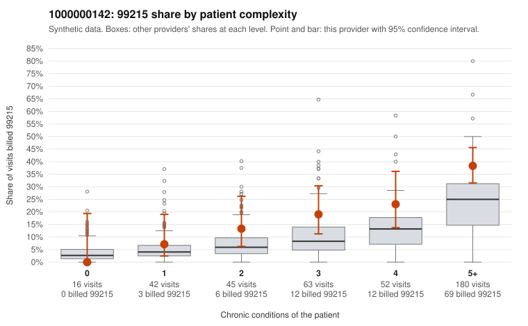

# 1000000142: 1000000142: documented 99215 claims mostly support the level billed (0% below)

**Leaning (advisory):** Pattern consistent with a high-acuity panel

## Why

1000000142 billed 99215 on 25.6% of 398 claims against an expected 12.5% given patient complexity (risk-adjusted score 3.04; plain z-score vs peers 3.25). 3% of this provider's 99215 claims were on patients with 0 or 1 chronic conditions. Records came back for 30 claims. Of 11 documented 99215 claims, 0 (0%) were documented below the billed level, against 33% for the comparison providers. Note checks on 30 returned notes (share showing each sign): problems 10%, late 7%, unsigned 0%, data 3%. No audit trail was received. 4 of 24 notes claiming moderate-or-higher data reviewed had no lab or test line on the claim. This pattern is consistent with a high-acuity panel. The sampled documentation supports the billed level. Examples: C0079914: billed 99215; documented MDM level high, 54 minutes. C0080022: billed 99215; documented MDM level high, 46 minutes. C0080255: billed 99215; documented MDM level high, 47 minutes. C0079889: billed 99215, patient aged 77 with 5 chronic condition(s) (type 2 diabetes;hyperlipidemia;depression;COPD;asthma). C0079944: billed 99215, patient aged 96 with 5 chronic condition(s) (hypothyroidism;obesity;hyperlipidemia;hypertension;heart failure).

## Evidence chart

## Cited claims

`C0079914`, `C0080022`, `C0080255`, `C0079889`, `C0079944`

## Suggested next steps

- Do not pursue recovery on this evidence: 30 charts came back and they support the level billed (0 of 11 documented 99215 claims below the billed level).
- Revisit if the 99215 share keeps rising against peers or a larger sample shows unsupported claims.

---
Citations checked: 5/5 valid. Synthetic data. The leaning is advisory; the flag comes from the statistical screen, and no clinical documentation is available beyond the sampled records-review facts shown in the packet.
