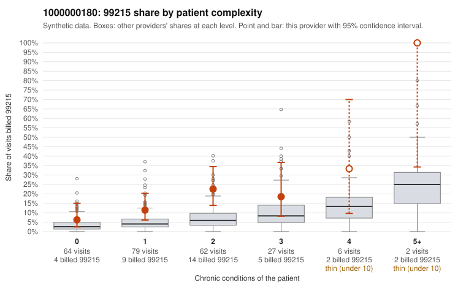

# 1000000180: 1000000180: too few returned records to judge

**Leaning (advisory):** Inconclusive

## Why

1000000180 billed 99215 on 15.0% of 240 claims against an expected 4.8% given patient complexity (risk-adjusted score 2.76; plain z-score vs peers 1.39). 36% of this provider's 99215 claims were on patients with 0 or 1 chronic conditions. Records came back for 34 claims. Of 16 documented 99215 claims, 4 (25%) were documented below the billed level, against 33% for the comparison providers. Note checks on 34 returned notes (share showing each sign): problems 38%, late 0%, unsigned 0%, data 6%. No audit trail was received. 3 of 27 notes claiming moderate-or-higher data reviewed had no lab or test line on the claim. The evidence does not support a call either way yet. Examples: C0098049: billed 99215, patient aged 18 with 0 chronic condition(s); documented MDM level moderate, minutes not recorded. C0098128: billed 99215; documented MDM level moderate, 37 minutes. C0097959: billed 99215, patient aged 62 with 1 chronic condition(s) (chronic kidney disease). C0097999: billed 99215, patient aged 50 with 1 chronic condition(s) (asthma).

## Evidence chart

## Cited claims

`C0098049`, `C0098128`, `C0097959`, `C0097999`

## Suggested next steps

- 34 charts came back but do not settle it: request a targeted sample of 99215 charts, starting with C0098049, C0098128, C0097959.
- Re-check after the targeted charts arrive; do not call upcoding or a sicker panel on this evidence alone.

---
Citations checked: 4/4 valid. Synthetic data. The leaning is advisory; the flag comes from the statistical screen, and no clinical documentation is available beyond the sampled records-review facts shown in the packet.
