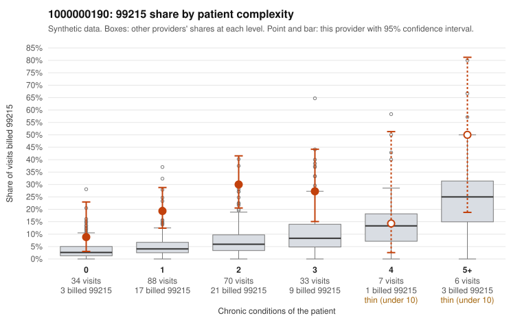

# 1000000190: 1000000190: too few returned records to judge

**Leaning (advisory):** Inconclusive

## Why

1000000190 billed 99215 on 22.7% of 238 claims against an expected 5.4% given patient complexity (risk-adjusted score 4.52; plain z-score vs peers 2.74). 37% of this provider's 99215 claims were on patients with 0 or 1 chronic conditions. Records came back for 26 claims. Of 9 documented 99215 claims, 5 (56%) were documented below the billed level, against 33% for the comparison providers. Note checks on 26 returned notes (share showing each sign): problems 19%, late 0%, unsigned 0%, data 0%. No audit trail was received. 0 of 18 notes claiming moderate-or-higher data reviewed had no lab or test line on the claim. The evidence does not support a call either way yet. Examples: C0103121: billed 99215; documented MDM level moderate, 31 minutes. C0103216: billed 99215, patient aged 45 with 1 chronic condition(s) (asthma); documented MDM level moderate, 31 minutes. C0103111: billed 99215, patient aged 50 with 1 chronic condition(s) (hypothyroidism). C0103113: billed 99215, patient aged 69 with 1 chronic condition(s) (hypothyroidism).

## Evidence chart

## Cited claims

`C0103121`, `C0103216`, `C0103111`, `C0103113`

## Suggested next steps

- 26 charts came back but do not settle it: request a targeted sample of 99215 charts, starting with C0103121, C0103216, C0103111.
- Re-check after the targeted charts arrive; do not call upcoding or a sicker panel on this evidence alone.

---
Citations checked: 4/4 valid. Synthetic data. The leaning is advisory; the flag comes from the statistical screen, and no clinical documentation is available beyond the sampled records-review facts shown in the packet.
