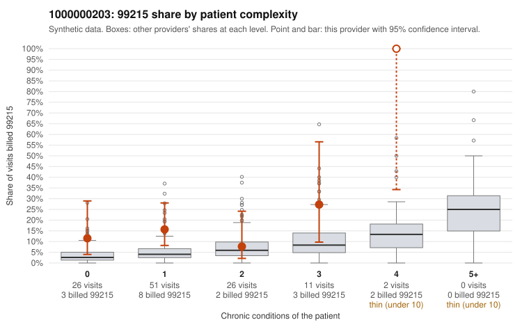

# 1000000203: 1000000203: too few returned records to judge

**Leaning (advisory):** Inconclusive

## Why

1000000203 billed 99215 on 15.5% of 116 claims against an expected 4.6% given patient complexity (risk-adjusted score 2.08; plain z-score vs peers 1.49). 61% of this provider's 99215 claims were on patients with 0 or 1 chronic conditions. Records came back for 30 claims. Of 6 documented 99215 claims, 1 (17%) were documented below the billed level, against 33% for the comparison providers. Note checks on 30 returned notes (share showing each sign): problems 37%, late 0%, unsigned 0%, data 7%, bulk created 0%, paste heavy 0%. 2 of 21 notes claiming moderate-or-higher data reviewed had no lab or test line on the claim. The evidence does not support a call either way yet. Examples: C0106991: billed 99215; documented MDM level moderate, minutes not recorded. C0106933: billed 99215, patient aged 53 with 1 chronic condition(s) (COPD); documented MDM level high, minutes not recorded. C0106935: billed 99215, patient aged 43 with 1 chronic condition(s) (osteoarthritis).

## Evidence chart

## Cited claims

`C0106991`, `C0106933`, `C0106935`

## Suggested next steps

- 30 charts came back but do not settle it: request a targeted sample of 99215 charts, starting with C0106991, C0106933, C0106935.
- Re-check after the targeted charts arrive; do not call upcoding or a sicker panel on this evidence alone.

---
Citations checked: 3/3 valid. Synthetic data. The leaning is advisory; the flag comes from the statistical screen, and no clinical documentation is available beyond the sampled records-review facts shown in the packet.
