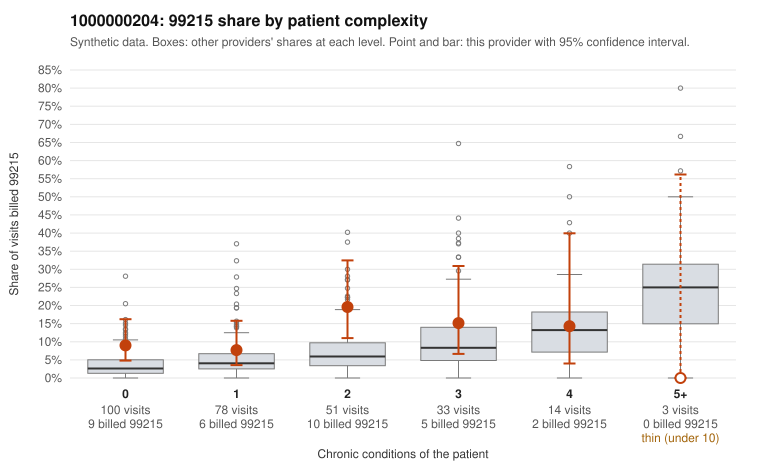

# 1000000204: 1000000204: 5 of 20 documented 99214 and 99215 claims (25%) are documented below the billed level

**Leaning (advisory):** Pattern consistent with upcoding

## Why

1000000204 billed 99215 on 11.5% of 279 claims against an expected 4.8% given patient complexity (risk-adjusted score 1.91; plain z-score vs peers 0.78). 47% of this provider's 99215 claims were on patients with 0 or 1 chronic conditions. Records came back for 30 claims. Of 4 documented 99215 claims, 2 (50%) were documented below the billed level, against 33% for the comparison providers. Note checks on 30 returned notes (share showing each sign): problems 17%, late 3%, unsigned 0%, data 0%. No audit trail was received. 0 of 17 notes claiming moderate-or-higher data reviewed had no lab or test line on the claim. This pattern is consistent with upcoding. It is a reason to review the records, not a finding. Examples: C0107264: billed 99215, patient aged 56 with 1 chronic condition(s) (chronic kidney disease); documented MDM level moderate, minutes not recorded. C0107284: billed 99215; documented MDM level moderate, minutes not recorded. C0107083: billed 99215, patient aged 40 with 1 chronic condition(s) (type 2 diabetes). C0107094: billed 99215, patient aged 34 with 0 chronic condition(s). C0107112: billed 99215, patient aged 39 with 0 chronic condition(s).

## Evidence chart

## Cited claims

`C0107264`, `C0107284`, `C0107083`, `C0107094`, `C0107112`

## Suggested next steps

- Request the full charts for C0107264, C0107284, C0107083 and have a certified coder re-score each against the current E/M rules (medical decision making or total time).
- If the re-scoring confirms the pattern, review the random sample in the recovery packet's sampling plan before any overpayment estimate; do not extrapolate from a targeted sample.
- Look at the notes themselves: 17% address fewer problems than their level implies and 3% were signed late; request the audit trail for C0107264, C0107284, C0107083.

---
Citations checked: 5/5 valid. Synthetic data. The leaning is advisory; the flag comes from the statistical screen, and no clinical documentation is available beyond the sampled records-review facts shown in the packet.
