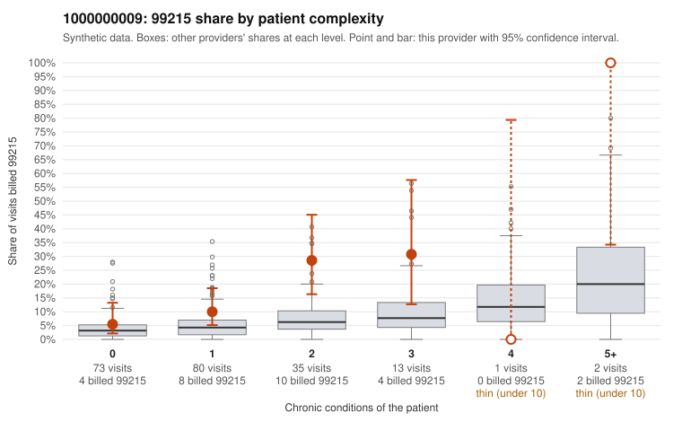

# 1000000009: 1000000009: too few returned records to judge

**Leaning (advisory):** Inconclusive

## Why

1000000009 billed 99215 on 13.7% of 204 claims against an expected 4.0% given patient complexity (risk-adjusted score 2.31; plain z-score vs peers 0.99). 43% of this provider's 99215 claims were on patients with 0 or 1 chronic conditions. Records came back for 45 claims. Of 16 documented 99215 claims, 3 (19%) were documented below the billed level, against 37% for the comparison providers. Note checks on 45 returned notes (share showing each sign): problems 47%, late 2%, unsigned 0%, data 2%, bulk created 0%, paste heavy 0%. 1 of 37 notes claiming moderate-or-higher data reviewed had no lab or test line on the claim. The evidence does not support a call either way yet. Examples: C0004900: billed 99215; documented MDM level moderate, minutes not recorded. C0004956: billed 99215, patient aged 67 with 0 chronic condition(s); documented MDM level moderate, 39 minutes. C0004961: billed 99215, patient aged 50 with 0 chronic condition(s).

## Evidence chart

## Cited claims

`C0004900`, `C0004956`, `C0004961`

## Suggested next steps

- 45 charts came back but do not settle it: request a targeted sample of 99215 charts, starting with C0004900, C0004956, C0004961.
- Re-check after the targeted charts arrive; do not call upcoding or a sicker panel on this evidence alone.

---
Citations checked: 3/3 valid. Synthetic data. The leaning is advisory; the flag comes from the statistical screen, and no clinical documentation is available beyond the sampled records-review facts shown in the packet.
