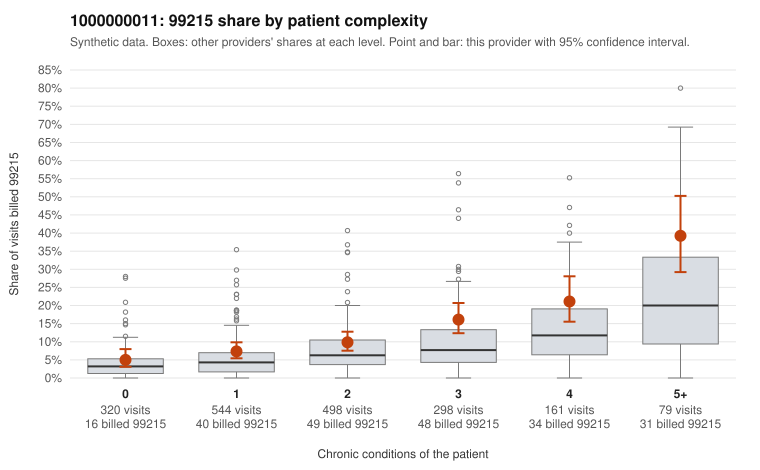

# 1000000011: 1000000011: too few returned records to judge

**Leaning (advisory):** Inconclusive

## Why

1000000011 billed 99215 on 11.5% of 1,900 claims against an expected 5.6% given patient complexity (risk-adjusted score 3.73; plain z-score vs peers 0.63). 26% of this provider's 99215 claims were on patients with 0 or 1 chronic conditions. Records came back for 15 claims. Of 2 documented 99215 claims, 0 (0%) were documented below the billed level, against 37% for the comparison providers. Note checks on 15 returned notes (share showing each sign): problems 20%, late 0%, unsigned 0%, data 0%. No audit trail was received. 1 of 9 notes claiming moderate-or-higher data reviewed had no lab or test line on the claim. The evidence does not support a call either way yet. Examples: C0005378: billed 99215, patient aged 56 with 0 chronic condition(s). C0005518: billed 99215, patient aged 18 with 1 chronic condition(s) (atrial fibrillation).

## Evidence chart

## Cited claims

`C0005378`, `C0005518`

## Suggested next steps

- 15 charts came back but do not settle it: request a targeted sample of 99215 charts, starting with C0005378, C0005518.
- Re-check after the targeted charts arrive; do not call upcoding or a sicker panel on this evidence alone.

---
Citations checked: 2/2 valid. Synthetic data. The leaning is advisory; the flag comes from the statistical screen, and no clinical documentation is available beyond the sampled records-review facts shown in the packet.
