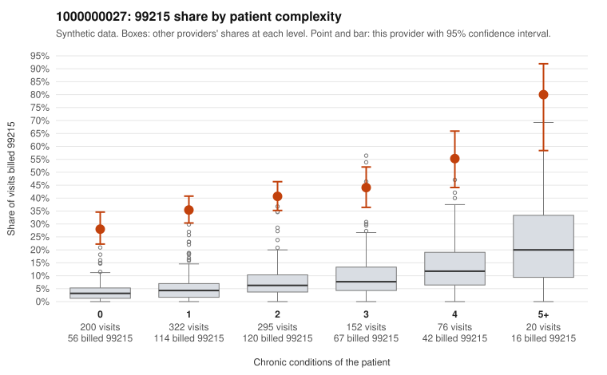

# 1000000027: 1000000027: too few returned records to judge

**Leaning (advisory):** Inconclusive

## Why

1000000027 billed 99215 on 39.0% of 1,065 claims against an expected 5.2% given patient complexity (risk-adjusted score 17.30; plain z-score vs peers 4.98). 41% of this provider's 99215 claims were on patients with 0 or 1 chronic conditions. Records came back for 30 claims. Of 15 documented 99215 claims, 0 (0%) were documented below the billed level, against 37% for the comparison providers. Note checks on 30 returned notes (share showing each sign): problems 20%, late 10%, unsigned 0%, data 13%. No audit trail was received. 4 of 28 notes claiming moderate-or-higher data reviewed had no lab or test line on the claim. The evidence does not support a call either way yet. Examples: C0019805: billed 99214; documented MDM level low, minutes not recorded. C0018764: billed 99215, patient aged 39 with 0 chronic condition(s). C0018765: billed 99215, patient aged 34 with 0 chronic condition(s).

## Evidence chart

## Cited claims

`C0019805`, `C0018764`, `C0018765`

## Suggested next steps

- 30 charts came back but do not settle it: request a targeted sample of 99215 charts, starting with C0019805, C0018764, C0018765.
- Re-check after the targeted charts arrive; do not call upcoding or a sicker panel on this evidence alone.

---
Citations checked: 3/3 valid. Synthetic data. The leaning is advisory; the flag comes from the statistical screen, and no clinical documentation is available beyond the sampled records-review facts shown in the packet.
