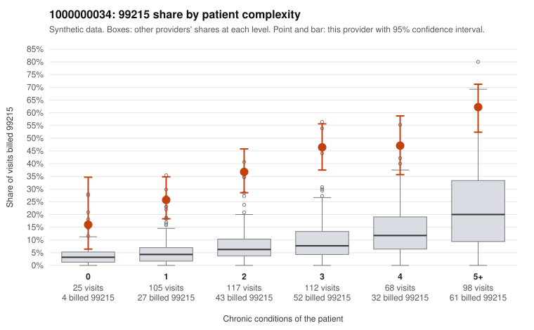

# 1000000034: 1000000034: too few returned records to judge

**Leaning (advisory):** Inconclusive

## Why

1000000034 billed 99215 on 41.7% of 525 claims against an expected 8.2% given patient complexity (risk-adjusted score 9.78; plain z-score vs peers 5.41). 14% of this provider's 99215 claims were on patients with 0 or 1 chronic conditions. Records came back for 30 claims. Of 16 documented 99215 claims, 5 (31%) were documented below the billed level, against 37% for the comparison providers. Note checks on 30 returned notes (share showing each sign): problems 7%, late 10%, unsigned 0%, data 7%. No audit trail was received. 2 of 24 notes claiming moderate-or-higher data reviewed had no lab or test line on the claim. The evidence does not support a call either way yet. Examples: C0024836: billed 99215; documented MDM level moderate, 36 minutes. C0024968: billed 99215, patient aged 40 with 1 chronic condition(s) (hyperlipidemia); documented MDM level moderate, 31 minutes. C0024826: billed 99215, patient aged 46 with 1 chronic condition(s) (hyperlipidemia). C0024831: billed 99215, patient aged 46 with 0 chronic condition(s).

## Evidence chart

## Cited claims

`C0024836`, `C0024968`, `C0024826`, `C0024831`

## Suggested next steps

- 30 charts came back but do not settle it: request a targeted sample of 99215 charts, starting with C0024836, C0024968, C0024826.
- Re-check after the targeted charts arrive; do not call upcoding or a sicker panel on this evidence alone.

---
Citations checked: 4/4 valid. Synthetic data. The leaning is advisory; the flag comes from the statistical screen, and no clinical documentation is available beyond the sampled records-review facts shown in the packet.
