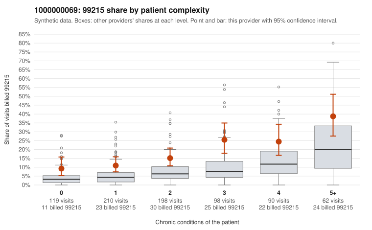

# 1000000069: 1000000069: documented 99215 claims mostly support the level billed (15% below)

**Leaning (advisory):** Pattern consistent with a high-acuity panel

## Why

1000000069 billed 99215 on 17.4% of 777 claims against an expected 6.3% given patient complexity (risk-adjusted score 4.35; plain z-score vs peers 1.56). 25% of this provider's 99215 claims were on patients with 0 or 1 chronic conditions. Records came back for 44 claims. Of 20 documented 99215 claims, 3 (15%) were documented below the billed level, against 37% for the comparison providers. Note checks on 44 returned notes (share showing each sign): problems 20%, late 11%, unsigned 0%, data 9%. No audit trail was received. 7 of 35 notes claiming moderate-or-higher data reviewed had no lab or test line on the claim. This pattern is consistent with a high-acuity panel. The sampled documentation supports the billed level. Examples: C0040757: billed 99215; documented MDM level high, 45 minutes. C0041027: billed 99215, patient aged 26 with 0 chronic condition(s); documented MDM level high, 50 minutes. C0041220: billed 99215; documented MDM level high, 32 minutes. C0040572: billed 99215, patient aged 69 with 4 chronic condition(s) (hypothyroidism;type 2 diabetes;hyperlipidemia;asthma). C0040691: billed 99215, patient aged 67 with 4 chronic condition(s) (type 2 diabetes;hyperlipidemia;hypertension;osteoarthritis).

## Evidence chart

## Cited claims

`C0040757`, `C0041027`, `C0041220`, `C0040572`, `C0040691`

## Suggested next steps

- Do not pursue recovery on this evidence: 44 charts came back and they support the level billed (3 of 20 documented 99215 claims below the billed level).
- Revisit if the 99215 share keeps rising against peers or a larger sample shows unsupported claims.

---
Citations checked: 5/5 valid. Synthetic data. The leaning is advisory; the flag comes from the statistical screen, and no clinical documentation is available beyond the sampled records-review facts shown in the packet.
