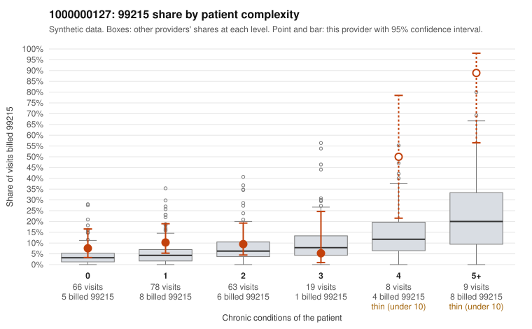

# 1000000127: 1000000127: documented 99215 claims mostly support the level billed (15% below)

**Leaning (advisory):** Pattern consistent with a high-acuity panel

## Why

1000000127 billed 99215 on 13.2% of 243 claims against an expected 4.8% given patient complexity (risk-adjusted score 1.96; plain z-score vs peers 0.90). 41% of this provider's 99215 claims were on patients with 0 or 1 chronic conditions. Records came back for 45 claims. Of 20 documented 99215 claims, 3 (15%) were documented below the billed level, against 37% for the comparison providers. Note checks on 45 returned notes (share showing each sign): problems 36%, late 2%, unsigned 0%, data 0%, bulk created 0%, paste heavy 0%. 3 of 29 notes claiming moderate-or-higher data reviewed had no lab or test line on the claim. This pattern is consistent with a high-acuity panel. The sampled documentation supports the billed level. Examples: C0068747: billed 99215, patient aged 69 with 4 chronic condition(s) (type 2 diabetes;depression;hypertension;osteoarthritis); documented MDM level high, 44 minutes. C0068835: billed 99215, patient aged 37 with 0 chronic condition(s); documented MDM level high, 35 minutes. C0068853: billed 99215, patient aged 54 with 5 chronic condition(s) (hypothyroidism;type 2 diabetes;hyperlipidemia;depression;heart failure); documented MDM level high, 47 minutes. C0068779: billed 99215, patient aged 87 with 5 chronic condition(s) (hypothyroidism;type 2 diabetes;obesity;hypertension;COPD).

## Evidence chart

## Cited claims

`C0068747`, `C0068835`, `C0068853`, `C0068779`

## Suggested next steps

- Do not pursue recovery on this evidence: 45 charts came back and they support the level billed (3 of 20 documented 99215 claims below the billed level).
- Revisit if the 99215 share keeps rising against peers or a larger sample shows unsupported claims.

---
Citations checked: 4/4 valid. Synthetic data. The leaning is advisory; the flag comes from the statistical screen, and no clinical documentation is available beyond the sampled records-review facts shown in the packet.
