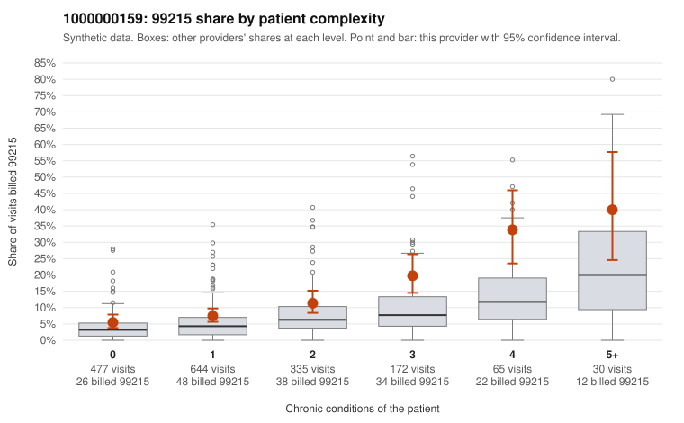

# 1000000159: 1000000159: too few returned records to judge

**Leaning (advisory):** Inconclusive

## Why

1000000159 billed 99215 on 10.4% of 1,723 claims against an expected 4.6% given patient complexity (risk-adjusted score 3.93; plain z-score vs peers 0.47). 41% of this provider's 99215 claims were on patients with 0 or 1 chronic conditions. Records came back for 30 claims. Of 4 documented 99215 claims, 1 (25%) were documented below the billed level, against 37% for the comparison providers. Note checks on 30 returned notes (share showing each sign): problems 23%, late 0%, unsigned 0%, data 3%. No audit trail was received. 2 of 17 notes claiming moderate-or-higher data reviewed had no lab or test line on the claim. The evidence does not support a call either way yet. Examples: C0089066: billed 99215; documented MDM level moderate, 31 minutes. C0087750: billed 99215, patient aged 64 with 1 chronic condition(s) (obesity). C0087839: billed 99215, patient aged 50 with 1 chronic condition(s) (COPD).

## Evidence chart

## Cited claims

`C0089066`, `C0087750`, `C0087839`

## Suggested next steps

- 30 charts came back but do not settle it: request a targeted sample of 99215 charts, starting with C0089066, C0087750, C0087839.
- Re-check after the targeted charts arrive; do not call upcoding or a sicker panel on this evidence alone.

---
Citations checked: 3/3 valid. Synthetic data. The leaning is advisory; the flag comes from the statistical screen, and no clinical documentation is available beyond the sampled records-review facts shown in the packet.
