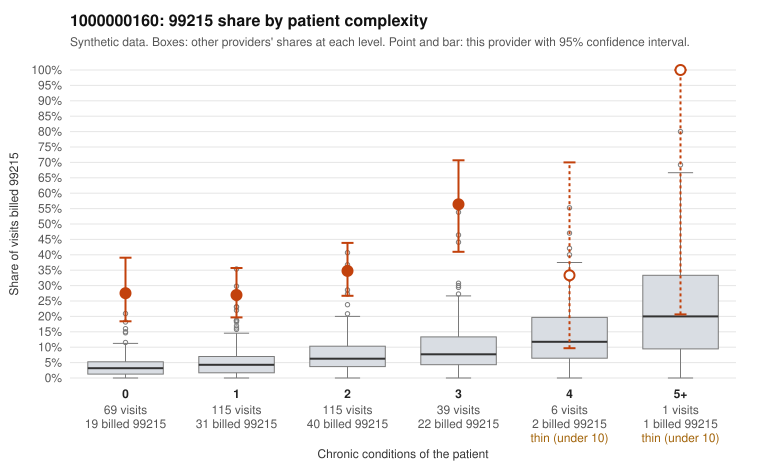

# 1000000160: 1000000160: too few returned records to judge

**Leaning (advisory):** Inconclusive

## Why

1000000160 billed 99215 on 33.3% of 345 claims against an expected 4.6% given patient complexity (risk-adjusted score 8.76; plain z-score vs peers 4.09). 43% of this provider's 99215 claims were on patients with 0 or 1 chronic conditions. Records came back for 29 claims. Of 9 documented 99215 claims, 0 (0%) were documented below the billed level, against 37% for the comparison providers. Note checks on 29 returned notes (share showing each sign): problems 34%, late 3%, unsigned 0%, data 7%. No audit trail was received. 3 of 25 notes claiming moderate-or-higher data reviewed had no lab or test line on the claim. The evidence does not support a call either way yet. Examples: C0089667: billed 99214; documented MDM level low, minutes not recorded. C0089513: billed 99215, patient aged 45 with 1 chronic condition(s) (depression). C0089520: billed 99215, patient aged 60 with 1 chronic condition(s) (heart failure).

## Evidence chart

## Cited claims

`C0089667`, `C0089513`, `C0089520`

## Suggested next steps

- 29 charts came back but do not settle it: request a targeted sample of 99215 charts, starting with C0089667, C0089513, C0089520.
- Re-check after the targeted charts arrive; do not call upcoding or a sicker panel on this evidence alone.

---
Citations checked: 3/3 valid. Synthetic data. The leaning is advisory; the flag comes from the statistical screen, and no clinical documentation is available beyond the sampled records-review facts shown in the packet.
