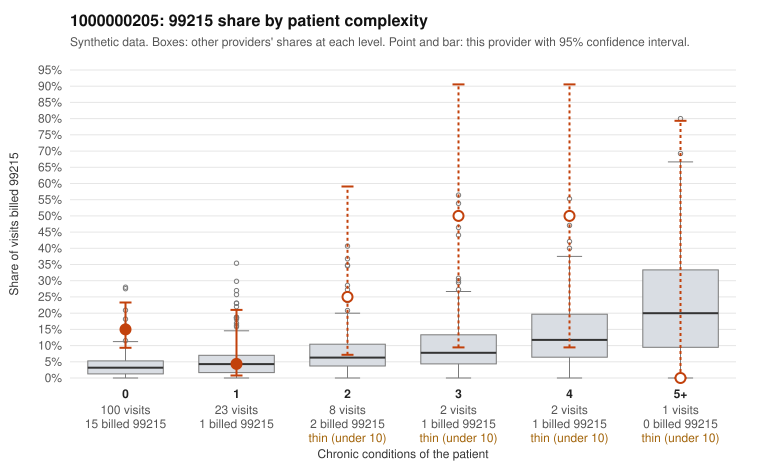

# 1000000205: 1000000205: too few returned records to judge

**Leaning (advisory):** Inconclusive

## Why

1000000205 billed 99215 on 14.7% of 136 claims against an expected 3.3% given patient complexity (risk-adjusted score 2.42; plain z-score vs peers 1.14). 80% of this provider's 99215 claims were on patients with 0 or 1 chronic conditions. Records came back for 45 claims. Of 18 documented 99215 claims, 2 (11%) were documented below the billed level, against 37% for the comparison providers. Note checks on 45 returned notes (share showing each sign): problems 58%, late 4%, unsigned 0%, data 2%. No audit trail was received. 1 of 27 notes claiming moderate-or-higher data reviewed had no lab or test line on the claim. The evidence does not support a call either way yet. Examples: C0109508: billed 99215; documented MDM level moderate, 35 minutes. C0109592: billed 99215, patient aged 40 with 0 chronic condition(s); documented MDM level moderate, minutes not recorded. C0109502: billed 99215, patient aged 24 with 0 chronic condition(s). C0109503: billed 99215, patient aged 48 with 0 chronic condition(s).

## Evidence chart

## Cited claims

`C0109508`, `C0109592`, `C0109502`, `C0109503`

## Suggested next steps

- 45 charts came back but do not settle it: request a targeted sample of 99215 charts, starting with C0109508, C0109592, C0109502.
- Re-check after the targeted charts arrive; do not call upcoding or a sicker panel on this evidence alone.

---
Citations checked: 4/4 valid. Synthetic data. The leaning is advisory; the flag comes from the statistical screen, and no clinical documentation is available beyond the sampled records-review facts shown in the packet.
