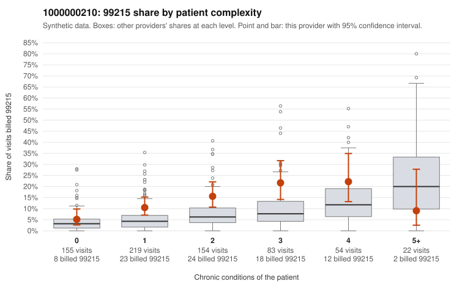

# 1000000210: 1000000210: documented 99215 claims mostly support the level billed (11% below)

**Leaning (advisory):** Pattern consistent with a high-acuity panel

## Why

1000000210 billed 99215 on 12.7% of 687 claims against an expected 5.2% given patient complexity (risk-adjusted score 2.92; plain z-score vs peers 0.82). 36% of this provider's 99215 claims were on patients with 0 or 1 chronic conditions. Records came back for 30 claims. Of 9 documented 99215 claims, 1 (11%) were documented below the billed level, against 37% for the comparison providers. Note checks on 30 returned notes (share showing each sign): problems 17%, late 7%, unsigned 0%, data 0%. No audit trail was received. 0 of 19 notes claiming moderate-or-higher data reviewed had no lab or test line on the claim. This pattern is consistent with a high-acuity panel. The sampled documentation supports the billed level. Examples: C0110544: billed 99215; documented MDM level high, 42 minutes. C0110598: billed 99215; documented MDM level high, minutes not recorded. C0110707: billed 99215; documented MDM level high, minutes not recorded. C0110406: billed 99215, patient aged 65 with 5 chronic condition(s) (type 2 diabetes;obesity;hyperlipidemia;depression;hypertension). C0110584: billed 99215, patient aged 38 with 4 chronic condition(s) (hypothyroidism;type 2 diabetes;hyperlipidemia;chronic kidney disease).

## Evidence chart

## Cited claims

`C0110544`, `C0110598`, `C0110707`, `C0110406`, `C0110584`

## Suggested next steps

- Do not pursue recovery on this evidence: 30 charts came back and they support the level billed (1 of 9 documented 99215 claims below the billed level).
- Revisit if the 99215 share keeps rising against peers or a larger sample shows unsupported claims.

---
Citations checked: 5/5 valid. Synthetic data. The leaning is advisory; the flag comes from the statistical screen, and no clinical documentation is available beyond the sampled records-review facts shown in the packet.
