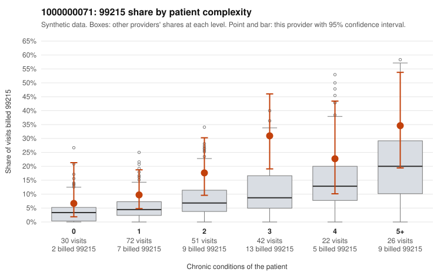

# 1000000071: 1000000071: 5 of 7 documented 99215 claims (71%) are documented below the billed level

**Leaning (advisory):** Pattern consistent with upcoding

## Why

1000000071 billed 99215 on 18.5% of 243 claims against an expected 7.0% given patient complexity (risk-adjusted score 2.54; plain z-score vs peers 2.06). 20% of this provider's 99215 claims were on patients with 0 or 1 chronic conditions. Records came back for 29 claims. Of 7 documented 99215 claims, 5 (71%) were documented below the billed level, against 21% for the comparison providers. Note checks on 29 returned notes (share showing each sign): problems 10%, late 0%, unsigned 0%, data 0%. No audit trail was received. 0 of 19 notes claiming moderate-or-higher data reviewed had no lab or test line on the claim. This pattern is consistent with upcoding. It is a reason to review the records, not a finding. Examples: C0032617: billed 99215, patient aged 77 with 5 chronic condition(s) (hypothyroidism;type 2 diabetes;obesity;hypertension;heart failure); documented MDM level moderate, minutes not recorded. C0032634: billed 99215, patient aged 26 with 4 chronic condition(s) (type 2 diabetes;hyperlipidemia;hypertension;osteoarthritis); documented MDM level moderate, minutes not recorded. C0032670: billed 99215, patient aged 28 with 1 chronic condition(s) (COPD); documented MDM level moderate, 24 minutes. C0032656: billed 99215, patient aged 21 with 1 chronic condition(s) (obesity). C0032664: billed 99215, patient aged 49 with 0 chronic condition(s). C0032669: billed 99215, patient aged 20 with 0 chronic condition(s).

## Evidence chart

## Cited claims

`C0032617`, `C0032634`, `C0032670`, `C0032656`, `C0032664`, `C0032669`

## Suggested next steps

- Request the full charts for C0032617, C0032634, C0032670 and have a certified coder re-score each against the current E/M rules (medical decision making or total time).
- If the re-scoring confirms the pattern, review the random sample in the recovery packet's sampling plan before any overpayment estimate; do not extrapolate from a targeted sample.
- Look at the notes themselves: 10% address fewer problems than their level implies and 0% were signed late; request the audit trail for C0032617, C0032634, C0032670.

---
Citations checked: 6/6 valid. Synthetic data. The leaning is advisory; the flag comes from the statistical screen, and no clinical documentation is available beyond the sampled records-review facts shown in the packet.
