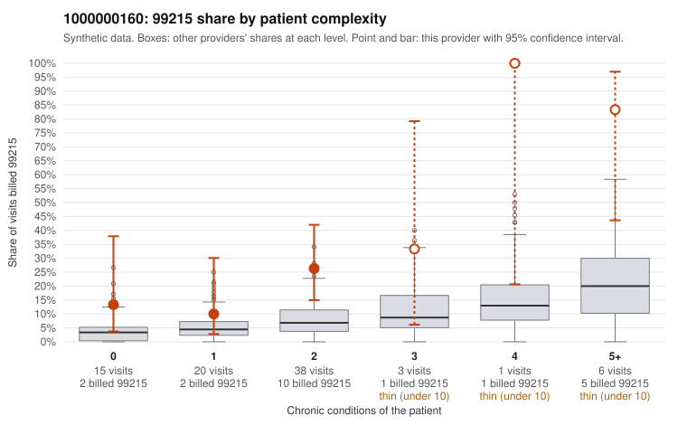

# 1000000160: 1000000160: too few returned records to judge

**Leaning (advisory):** Inconclusive

## Why

1000000160 billed 99215 on 25.3% of 83 claims against an expected 5.9% given patient complexity (risk-adjusted score 2.72; plain z-score vs peers 3.33). 19% of this provider's 99215 claims were on patients with 0 or 1 chronic conditions. Records came back for 30 claims. Of 8 documented 99215 claims, 2 (25%) were documented below the billed level, against 21% for the comparison providers. Note checks on 30 returned notes (share showing each sign): problems 20%, late 7%, unsigned 0%, data 3%. No audit trail was received. 3 of 23 notes claiming moderate-or-higher data reviewed had no lab or test line on the claim. The evidence does not support a call either way yet. Examples: C0073253: billed 99215; documented MDM level moderate, minutes not recorded. C0073294: billed 99215, patient aged 47 with 1 chronic condition(s) (asthma); documented MDM level moderate, minutes not recorded. C0073232: billed 99215, patient aged 31 with 1 chronic condition(s) (osteoarthritis). C0073236: billed 99215, patient aged 28 with 0 chronic condition(s).

## Evidence chart

## Cited claims

`C0073253`, `C0073294`, `C0073232`, `C0073236`

## Suggested next steps

- 30 charts came back but do not settle it: request a targeted sample of 99215 charts, starting with C0073253, C0073294, C0073232.
- Re-check after the targeted charts arrive; do not call upcoding or a sicker panel on this evidence alone.

---
Citations checked: 4/4 valid. Synthetic data. The leaning is advisory; the flag comes from the statistical screen, and no clinical documentation is available beyond the sampled records-review facts shown in the packet.
