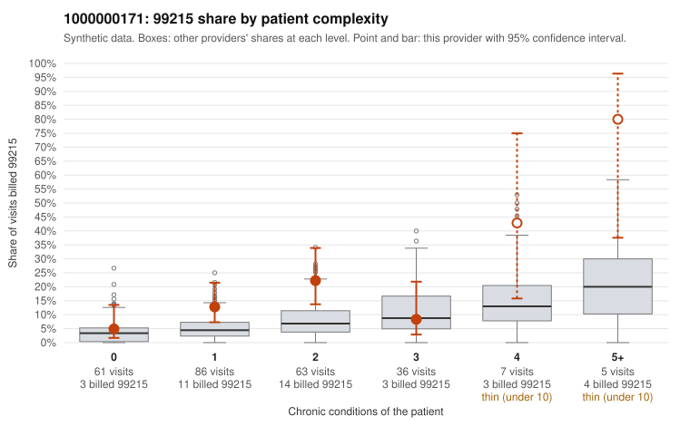

# 1000000171: 1000000171: documented 99215 claims mostly support the level billed (10% below)

**Leaning (advisory):** Pattern consistent with a high-acuity panel

## Why

1000000171 billed 99215 on 14.7% of 258 claims against an expected 5.3% given patient complexity (risk-adjusted score 2.44; plain z-score vs peers 1.36). 37% of this provider's 99215 claims were on patients with 0 or 1 chronic conditions. Records came back for 45 claims. Of 19 documented 99215 claims, 2 (10%) were documented below the billed level, against 21% for the comparison providers. Note checks on 45 returned notes (share showing each sign): problems 33%, late 7%, unsigned 0%, data 0%. No audit trail was received. 1 of 34 notes claiming moderate-or-higher data reviewed had no lab or test line on the claim. This pattern is consistent with a high-acuity panel. The sampled documentation supports the billed level. Examples: C0077526: billed 99215; documented MDM level high, minutes not recorded. C0077595: billed 99215, patient aged 49 with 0 chronic condition(s); documented MDM level high, 41 minutes. C0077614: billed 99215; documented MDM level high, 53 minutes. C0077509: billed 99215, patient aged 44 with 5 chronic condition(s) (hyperlipidemia;hypertension;atrial fibrillation;heart failure;COPD). C0077534: billed 99215, patient aged 68 with 4 chronic condition(s) (obesity;depression;hypertension;atrial fibrillation).

## Evidence chart

## Cited claims

`C0077526`, `C0077595`, `C0077614`, `C0077509`, `C0077534`

## Suggested next steps

- Do not pursue recovery on this evidence: 45 charts came back and they support the level billed (2 of 19 documented 99215 claims below the billed level).
- Revisit if the 99215 share keeps rising against peers or a larger sample shows unsupported claims.

---
Citations checked: 5/5 valid. Synthetic data. The leaning is advisory; the flag comes from the statistical screen, and no clinical documentation is available beyond the sampled records-review facts shown in the packet.
