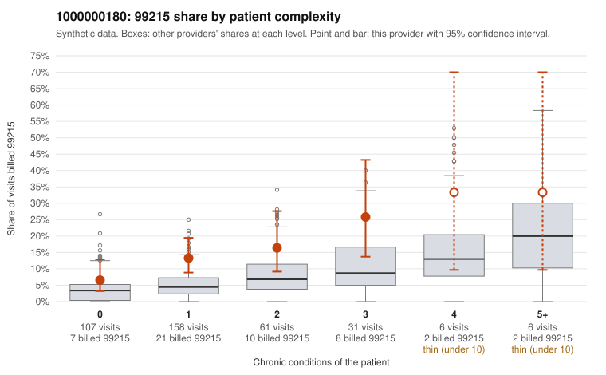

# 1000000180: 1000000180: too few returned records to judge

**Leaning (advisory):** Inconclusive

## Why

1000000180 billed 99215 on 13.6% of 369 claims against an expected 4.7% given patient complexity (risk-adjusted score 2.89; plain z-score vs peers 1.14). 56% of this provider's 99215 claims were on patients with 0 or 1 chronic conditions. Records came back for 13 claims. Of 2 documented 99215 claims, 0 (0%) were documented below the billed level, against 21% for the comparison providers. Note checks on 13 returned notes (share showing each sign): problems 23%, late 0%, unsigned 0%, data 0%. No audit trail was received. 0 of 9 notes claiming moderate-or-higher data reviewed had no lab or test line on the claim. The evidence does not support a call either way yet. Examples: C0082699: billed 99214; documented MDM level low, minutes not recorded. C0082614: billed 99215, patient aged 60 with 1 chronic condition(s) (osteoarthritis). C0082637: billed 99215, patient aged 47 with 0 chronic condition(s).

## Evidence chart

## Cited claims

`C0082699`, `C0082614`, `C0082637`

## Suggested next steps

- 13 charts came back but do not settle it: request a targeted sample of 99215 charts, starting with C0082699, C0082614, C0082637.
- Re-check after the targeted charts arrive; do not call upcoding or a sicker panel on this evidence alone.

---
Citations checked: 3/3 valid. Synthetic data. The leaning is advisory; the flag comes from the statistical screen, and no clinical documentation is available beyond the sampled records-review facts shown in the packet.
