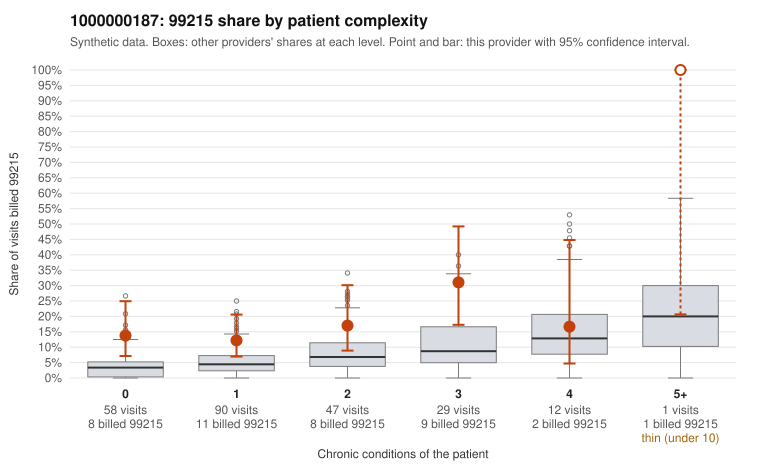

# 1000000187: 1000000187: 12 of 20 documented 99215 claims (60%) are documented below the billed level

**Leaning (advisory):** Pattern consistent with upcoding

## Why

1000000187 billed 99215 on 16.5% of 237 claims against an expected 5.1% given patient complexity (risk-adjusted score 2.88; plain z-score vs peers 1.68). 49% of this provider's 99215 claims were on patients with 0 or 1 chronic conditions. Records came back for 45 claims. Of 20 documented 99215 claims, 12 (60%) were documented below the billed level, against 21% for the comparison providers. Note checks on 45 returned notes (share showing each sign): problems 13%, late 0%, unsigned 0%, data 2%. No audit trail was received. 2 of 25 notes claiming moderate-or-higher data reviewed had no lab or test line on the claim. This pattern is consistent with upcoding. It is a reason to review the records, not a finding. Examples: C0085930: billed 99215, patient aged 52 with 0 chronic condition(s); documented MDM level moderate, 37 minutes. C0085986: billed 99215, patient aged 47 with 1 chronic condition(s) (hypertension); documented MDM level moderate, minutes not recorded. C0085994: billed 99215; documented MDM level low, minutes not recorded. C0085882: billed 99215, patient aged 46 with 1 chronic condition(s) (obesity); documented MDM level high, 47 minutes. C0085909: billed 99215, patient aged 43 with 0 chronic condition(s). C0085915: billed 99215, patient aged 34 with 0 chronic condition(s).

## Evidence chart

## Cited claims

`C0085930`, `C0085986`, `C0085994`, `C0085882`, `C0085909`, `C0085915`

## Suggested next steps

- Request the full charts for C0085930, C0085986, C0085994 and have a certified coder re-score each against the current E/M rules (medical decision making or total time).
- If the re-scoring confirms the pattern, review the random sample in the recovery packet's sampling plan before any overpayment estimate; do not extrapolate from a targeted sample.
- Look at the notes themselves: 13% address fewer problems than their level implies and 0% were signed late; request the audit trail for C0085930, C0085986, C0085994.

---
Citations checked: 6/6 valid. Synthetic data. The leaning is advisory; the flag comes from the statistical screen, and no clinical documentation is available beyond the sampled records-review facts shown in the packet.
