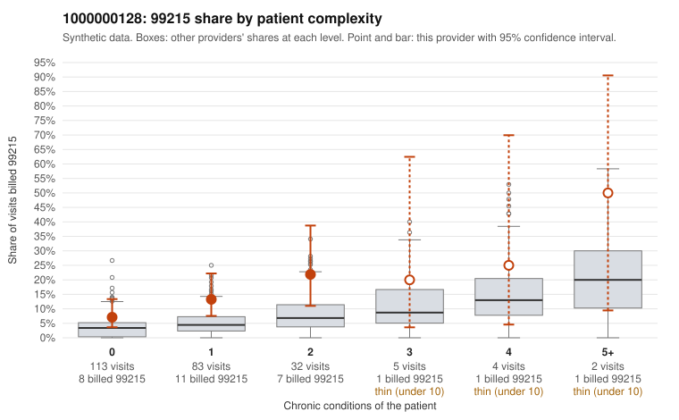

# Payment Integrity dossier: 1000000128

> Draft for human review. Statistical and records-sample evidence only; not a finding. Compliance or legal review is needed before any provider contact, notice or recoupment.

## Provider overview

| | |
|---|---|
| Specialty / state | Family Practice, GA (synthetic) |
| Claims / patients | 239 / 121 |
| Billed mix (99211 to 99215) | 9 / 1 / 94 / 106 / 29 |
| 99215 share | 12.1% |
| Expected 99215 share given patient complexity | 4.1% |
| Screen scores | z vs peers 0.87; risk-adjusted 2.22; flagged by eb_ratio_t |

## Case summary (advisory)

**1000000128: 5 of 17 documented 99214 and 99215 claims (29%) are documented below the billed level**

Leaning: pattern consistent with upcoding. Citations checked: 4/4 valid.

1000000128 billed 99215 on 12.1% of 239 claims against an expected 4.1% given patient complexity (risk-adjusted score 2.22; plain z-score vs peers 0.87). 66% of this provider's 99215 claims were on patients with 0 or 1 chronic conditions. Records came back for 30 claims. Of 2 documented 99215 claims, 1 (50%) were documented below the billed level, against 21% for the comparison providers. Note checks on 30 returned notes (share showing each sign): problems 30%, late 7%, unsigned 0%, data 0%. No audit trail was received. 0 of 11 notes claiming moderate-or-higher data reviewed had no lab or test line on the claim. This pattern is consistent with upcoding. It is a reason to review the records, not a finding. Examples: C0059993: billed 99215, patient aged 44 with 1 chronic condition(s) (hypertension); documented MDM level moderate, minutes not recorded. C0059841: billed 99215, patient aged 33 with 0 chronic condition(s). C0059854: billed 99215, patient aged 66 with 1 chronic condition(s) (type 2 diabetes). C0059855: billed 99215, patient aged 35 with 1 chronic condition(s) (obesity).

## Evidence chart

## Records-review sample so far

Documentation is on file for 30 claims (13% of this provider's claims).

| Billed | Documented | Documentation below billed level | Rate | All-provider rate |
|---|---|---|---|---|
| 99213 | 13 | 1 | 7.7% | 2.6% |
| 99214 | 15 | 4 | 26.7% | 6.4% |
| 99215 | 2 | 1 | 50.0% | 20.7% |

## Recommended next steps for Payment Integrity

1. Request records for the sampled claims in `record_request_list.csv` (29 claims across 99215).
2. Review the records against E/M documentation rules and record the supported level for each claim.
3. Run the overpayment estimator on the reviewed sample (`sampling_plan.md` explains how).
4. Notice, appeal rights, recoupment, education or corrective action, and any referral are decisions for the PI team, compliance and counsel. Nothing here drafts those.

Suggested follow-ups from the case summary:

- Request the full charts for C0059993, C0059841, C0059854 and have a certified coder re-score each against the current E/M rules (medical decision making or total time).
- If the re-scoring confirms the pattern, review the random sample in the recovery packet's sampling plan before any overpayment estimate; do not extrapolate from a targeted sample.
- Look at the notes themselves: 30% address fewer problems than their level implies and 7% were signed late; request the audit trail for C0059993, C0059841, C0059854.

## Limits

- Synthetic data; no real claims or providers.
- The leaning is advisory. The flag comes from the statistical screen; the summary explains it.
- The records-review sample is partial and was simulated for this project.
- Allowed amounts are GA Family Practice averages from a public CMS file, not this provider's actual payments.
