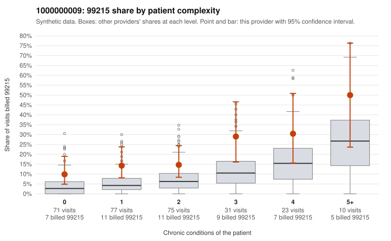

# 1000000009: 1000000009: too few returned records to judge

**Leaning (advisory):** Inconclusive

## Why

1000000009 billed 99215 on 17.4% of 287 claims against an expected 6.4% given patient complexity (risk-adjusted score 2.55; plain z-score vs peers 1.40). 36% of this provider's 99215 claims were on patients with 0 or 1 chronic conditions. Records came back for 30 claims. Of 3 documented 99215 claims, 0 (0%) were documented below the billed level, against 35% for the comparison providers. Note checks on 30 returned notes (share showing each sign): problems 27%, late 10%, unsigned 0%, data 0%. No audit trail was received. 2 of 24 notes claiming moderate-or-higher data reviewed had no lab or test line on the claim. The evidence does not support a call either way yet. Examples: C0003189: billed 99214; documented MDM level low, 23 minutes. C0003142: billed 99215, patient aged 57 with 1 chronic condition(s) (depression). C0003146: billed 99215, patient aged 57 with 1 chronic condition(s) (type 2 diabetes).

## Evidence chart

## Cited claims

`C0003189`, `C0003142`, `C0003146`

## Suggested next steps

- 30 charts came back but do not settle it: request a targeted sample of 99215 charts, starting with C0003189, C0003142, C0003146.
- Re-check after the targeted charts arrive; do not call upcoding or a sicker panel on this evidence alone.

---
Citations checked: 3/3 valid. Synthetic data. The leaning is advisory; the flag comes from the statistical screen, and no clinical documentation is available beyond the sampled records-review facts shown in the packet.
