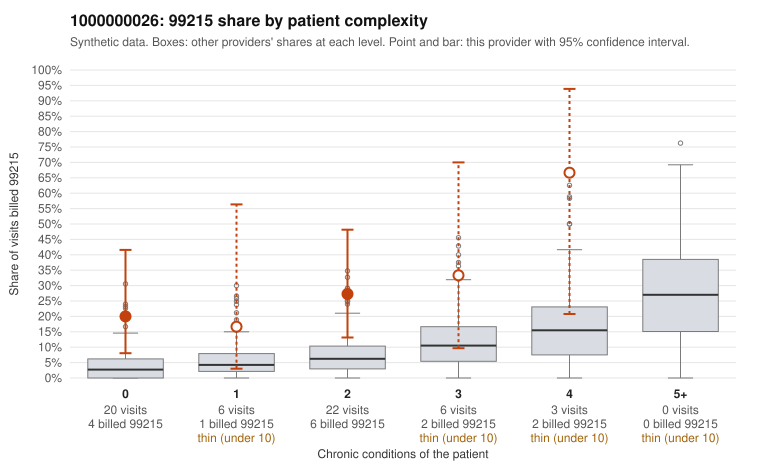

# 1000000026: 1000000026: too few returned records to judge

**Leaning (advisory):** Inconclusive

## Why

1000000026 billed 99215 on 26.3% of 57 claims against an expected 5.6% given patient complexity (risk-adjusted score 2.26; plain z-score vs peers 2.70). 33% of this provider's 99215 claims were on patients with 0 or 1 chronic conditions. Records came back for 30 claims. Of 8 documented 99215 claims, 2 (25%) were documented below the billed level, against 35% for the comparison providers. Note checks on 30 returned notes (share showing each sign): problems 30%, late 0%, unsigned 0%, data 13%. No audit trail was received. 5 of 24 notes claiming moderate-or-higher data reviewed had no lab or test line on the claim. The evidence does not support a call either way yet. Examples: C0010170: billed 99215, patient aged 55 with 0 chronic condition(s); documented MDM level moderate, 39 minutes. C0010196: billed 99215; documented MDM level moderate, 39 minutes. C0010154: billed 99215, patient aged 55 with 0 chronic condition(s); documented MDM level high, minutes not recorded.

## Evidence chart

## Cited claims

`C0010170`, `C0010196`, `C0010154`

## Suggested next steps

- 30 charts came back but do not settle it: request a targeted sample of 99215 charts, starting with C0010170, C0010196, C0010154.
- Re-check after the targeted charts arrive; do not call upcoding or a sicker panel on this evidence alone.

---
Citations checked: 3/3 valid. Synthetic data. The leaning is advisory; the flag comes from the statistical screen, and no clinical documentation is available beyond the sampled records-review facts shown in the packet.
