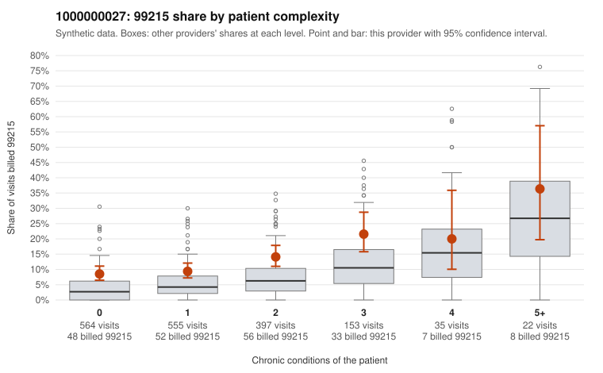

# 1000000027: 1000000027: too few returned records to judge

**Leaning (advisory):** Inconclusive

## Why

1000000027 billed 99215 on 11.8% of 1,726 claims against an expected 5.2% given patient complexity (risk-adjusted score 4.13; plain z-score vs peers 0.59). 49% of this provider's 99215 claims were on patients with 0 or 1 chronic conditions. Records came back for 30 claims. No documented 99215 claims came back. Note checks on 30 returned notes (share showing each sign): problems 27%, late 7%, unsigned 0%, data 20%. No audit trail was received. 6 of 19 notes claiming moderate-or-higher data reviewed had no lab or test line on the claim. The evidence does not support a call either way yet. Examples: C0011151: billed 99214; documented MDM level low, 25 minutes. C0010247: billed 99215, patient aged 51 with 1 chronic condition(s) (depression). C0010309: billed 99215, patient aged 31 with 0 chronic condition(s).

## Evidence chart

## Cited claims

`C0011151`, `C0010247`, `C0010309`

## Suggested next steps

- 30 charts came back but do not settle it: request a targeted sample of 99215 charts, starting with C0011151, C0010247, C0010309.
- Re-check after the targeted charts arrive; do not call upcoding or a sicker panel on this evidence alone.

---
Citations checked: 3/3 valid. Synthetic data. The leaning is advisory; the flag comes from the statistical screen, and no clinical documentation is available beyond the sampled records-review facts shown in the packet.
