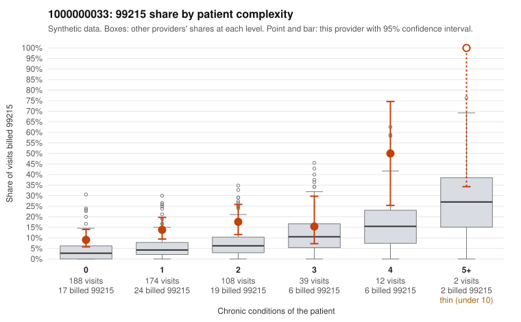

# 1000000033: 1000000033: documented 99215 claims mostly support the level billed (5% below)

**Leaning (advisory):** Pattern consistent with a high-acuity panel

## Why

1000000033 billed 99215 on 14.1% of 523 claims against an expected 4.9% given patient complexity (risk-adjusted score 3.25; plain z-score vs peers 0.93). 55% of this provider's 99215 claims were on patients with 0 or 1 chronic conditions. Records came back for 45 claims. Of 20 documented 99215 claims, 1 (5%) were documented below the billed level, against 35% for the comparison providers. Note checks on 45 returned notes (share showing each sign): problems 33%, late 2%, unsigned 0%, data 11%. No audit trail was received. 7 of 37 notes claiming moderate-or-higher data reviewed had no lab or test line on the claim. This pattern is consistent with a high-acuity panel. The sampled documentation supports the billed level. Examples: C0014166: billed 99215; documented MDM level high, 43 minutes. C0014184: billed 99215, patient aged 61 with 1 chronic condition(s) (hypothyroidism); documented MDM level high, minutes not recorded. C0014445: billed 99215; documented MDM level high, 46 minutes. C0014232: billed 99215, patient aged 79 with 4 chronic condition(s) (type 2 diabetes;obesity;heart failure;osteoarthritis). C0014270: billed 99215, patient aged 65 with 4 chronic condition(s) (hypothyroidism;obesity;depression;hypertension).

## Evidence chart

## Cited claims

`C0014166`, `C0014184`, `C0014445`, `C0014232`, `C0014270`

## Suggested next steps

- Do not pursue recovery on this evidence: 45 charts came back and they support the level billed (1 of 20 documented 99215 claims below the billed level).
- Revisit if the 99215 share keeps rising against peers or a larger sample shows unsupported claims.

---
Citations checked: 5/5 valid. Synthetic data. The leaning is advisory; the flag comes from the statistical screen, and no clinical documentation is available beyond the sampled records-review facts shown in the packet.
