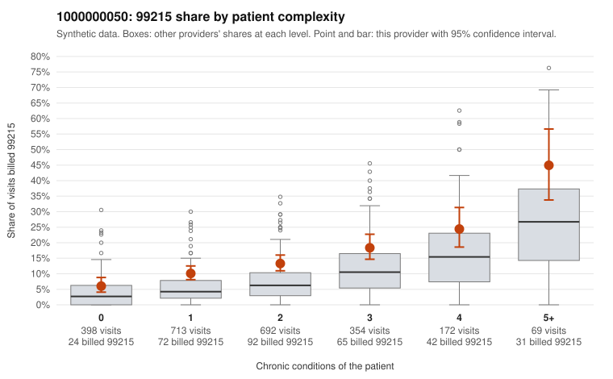

# 1000000050: 1000000050: too few returned records to judge

**Leaning (advisory):** Inconclusive

## Why

1000000050 billed 99215 on 13.6% of 2,398 claims against an expected 6.6% given patient complexity (risk-adjusted score 4.68; plain z-score vs peers 0.85). 29% of this provider's 99215 claims were on patients with 0 or 1 chronic conditions. Records came back for 30 claims. Of 4 documented 99215 claims, 1 (25%) were documented below the billed level, against 35% for the comparison providers. Note checks on 30 returned notes (share showing each sign): problems 13%, late 3%, unsigned 0%, data 0%. No audit trail was received. 2 of 18 notes claiming moderate-or-higher data reviewed had no lab or test line on the claim. The evidence does not support a call either way yet. Examples: C0024098: billed 99215; documented MDM level low, minutes not recorded. C0023955: billed 99215, patient aged 66 with 1 chronic condition(s) (type 2 diabetes). C0023984: billed 99215, patient aged 45 with 0 chronic condition(s).

## Evidence chart

## Cited claims

`C0024098`, `C0023955`, `C0023984`

## Suggested next steps

- 30 charts came back but do not settle it: request a targeted sample of 99215 charts, starting with C0024098, C0023955, C0023984.
- Re-check after the targeted charts arrive; do not call upcoding or a sicker panel on this evidence alone.

---
Citations checked: 3/3 valid. Synthetic data. The leaning is advisory; the flag comes from the statistical screen, and no clinical documentation is available beyond the sampled records-review facts shown in the packet.
