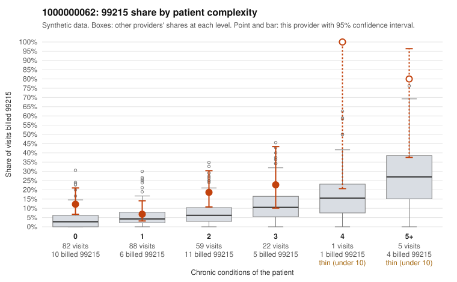

# 1000000062: 1000000062: too few returned records to judge

**Leaning (advisory):** Inconclusive

## Why

1000000062 billed 99215 on 14.4% of 257 claims against an expected 5.2% given patient complexity (risk-adjusted score 2.20; plain z-score vs peers 0.97). 43% of this provider's 99215 claims were on patients with 0 or 1 chronic conditions. Records came back for 30 claims. Of 6 documented 99215 claims, 3 (50%) were documented below the billed level, against 35% for the comparison providers. Note checks on 30 returned notes (share showing each sign): problems 43%, late 0%, unsigned 0%, data 0%, bulk created 0%, paste heavy 0%. 0 of 20 notes claiming moderate-or-higher data reviewed had no lab or test line on the claim. The evidence does not support a call either way yet. Examples: C0030109: billed 99215; documented MDM level moderate, minutes not recorded. C0030180: billed 99215, patient aged 32 with 1 chronic condition(s) (type 2 diabetes); documented MDM level moderate, minutes not recorded. C0030080: billed 99215, patient aged 44 with 0 chronic condition(s). C0030103: billed 99215, patient aged 67 with 0 chronic condition(s).

## Evidence chart

## Cited claims

`C0030109`, `C0030180`, `C0030080`, `C0030103`

## Suggested next steps

- 30 charts came back but do not settle it: request a targeted sample of 99215 charts, starting with C0030109, C0030180, C0030080.
- Re-check after the targeted charts arrive; do not call upcoding or a sicker panel on this evidence alone.

---
Citations checked: 4/4 valid. Synthetic data. The leaning is advisory; the flag comes from the statistical screen, and no clinical documentation is available beyond the sampled records-review facts shown in the packet.
