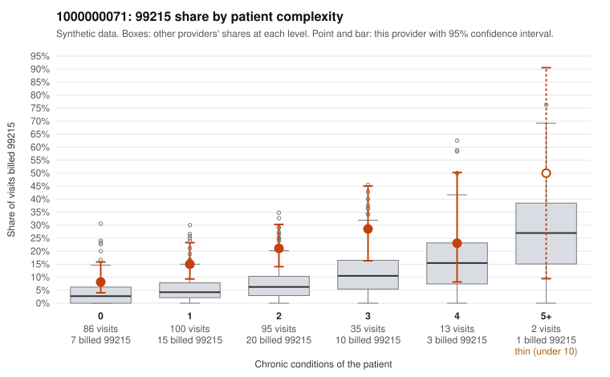

# 1000000071: 1000000071: too few returned records to judge

**Leaning (advisory):** Inconclusive

## Why

1000000071 billed 99215 on 16.9% of 331 claims against an expected 5.5% given patient complexity (risk-adjusted score 3.02; plain z-score vs peers 1.33). 39% of this provider's 99215 claims were on patients with 0 or 1 chronic conditions. Records came back for 30 claims. Of 5 documented 99215 claims, 1 (20%) were documented below the billed level, against 35% for the comparison providers. Note checks on 30 returned notes (share showing each sign): problems 27%, late 3%, unsigned 0%, data 3%. No audit trail was received. 2 of 20 notes claiming moderate-or-higher data reviewed had no lab or test line on the claim. The evidence does not support a call either way yet. Examples: C0033968: billed 99215, patient aged 67 with 1 chronic condition(s) (hypertension); documented MDM level moderate, 35 minutes. C0033747: billed 99215, patient aged 60 with 0 chronic condition(s). C0033750: billed 99215, patient aged 46 with 1 chronic condition(s) (heart failure).

## Evidence chart

## Cited claims

`C0033968`, `C0033747`, `C0033750`

## Suggested next steps

- 30 charts came back but do not settle it: request a targeted sample of 99215 charts, starting with C0033968, C0033747, C0033750.
- Re-check after the targeted charts arrive; do not call upcoding or a sicker panel on this evidence alone.

---
Citations checked: 3/3 valid. Synthetic data. The leaning is advisory; the flag comes from the statistical screen, and no clinical documentation is available beyond the sampled records-review facts shown in the packet.
