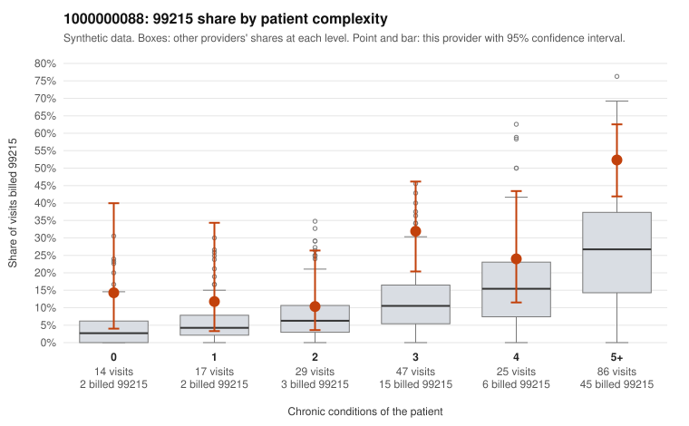

# 1000000088: 1000000088: documented 99215 claims mostly support the level billed (17% below)

**Leaning (advisory):** Pattern consistent with a high-acuity panel

## Why

1000000088 billed 99215 on 33.5% of 218 claims against an expected 14.1% given patient complexity (risk-adjusted score 2.80; plain z-score vs peers 3.74). 5% of this provider's 99215 claims were on patients with 0 or 1 chronic conditions. Records came back for 30 claims. Of 12 documented 99215 claims, 2 (17%) were documented below the billed level, against 35% for the comparison providers. Note checks on 30 returned notes (share showing each sign): problems 3%, late 7%, unsigned 0%, data 7%. No audit trail was received. 2 of 22 notes claiming moderate-or-higher data reviewed had no lab or test line on the claim. This pattern is consistent with a high-acuity panel. The sampled documentation supports the billed level. Examples: C0040127: billed 99215, patient aged 67 with 4 chronic condition(s) (obesity;hyperlipidemia;hypertension;osteoarthritis); documented MDM level high, minutes not recorded. C0040174: billed 99215; documented MDM level high, 48 minutes. C0040188: billed 99215; documented MDM level high, 43 minutes. C0040052: billed 99215, patient aged 69 with 5 chronic condition(s) (hypothyroidism;obesity;hyperlipidemia;depression;COPD). C0040061: billed 99215, patient aged 74 with 5 chronic condition(s) (hypothyroidism;type 2 diabetes;hyperlipidemia;depression;hypertension).

## Evidence chart

## Cited claims

`C0040127`, `C0040174`, `C0040188`, `C0040052`, `C0040061`

## Suggested next steps

- Do not pursue recovery on this evidence: 30 charts came back and they support the level billed (2 of 12 documented 99215 claims below the billed level).
- Revisit if the 99215 share keeps rising against peers or a larger sample shows unsupported claims.

---
Citations checked: 5/5 valid. Synthetic data. The leaning is advisory; the flag comes from the statistical screen, and no clinical documentation is available beyond the sampled records-review facts shown in the packet.
