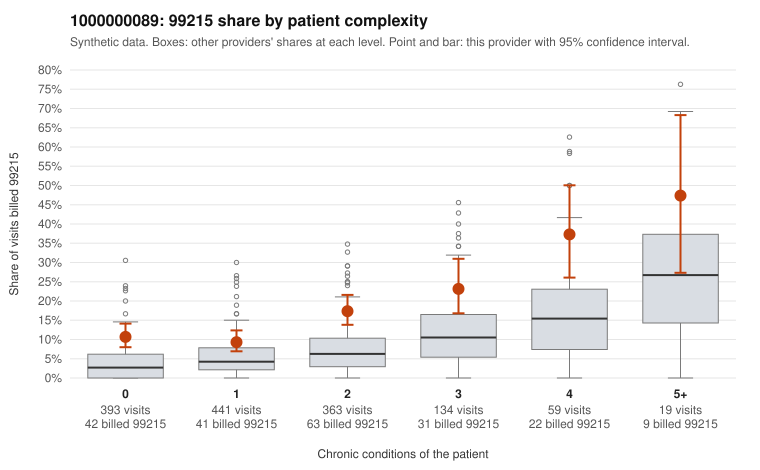

# 1000000089: 1000000089: documented 99215 claims mostly support the level billed (12% below)

**Leaning (advisory):** Pattern consistent with a high-acuity panel

## Why

1000000089 billed 99215 on 14.8% of 1,409 claims against an expected 5.6% given patient complexity (risk-adjusted score 5.07; plain z-score vs peers 1.02). 40% of this provider's 99215 claims were on patients with 0 or 1 chronic conditions. Records came back for 45 claims. Of 17 documented 99215 claims, 2 (12%) were documented below the billed level, against 35% for the comparison providers. Note checks on 45 returned notes (share showing each sign): problems 44%, late 0%, unsigned 0%, data 4%, bulk created 0%, paste heavy 0%. 3 of 32 notes claiming moderate-or-higher data reviewed had no lab or test line on the claim. This pattern is consistent with a high-acuity panel. The sampled documentation supports the billed level. Examples: C0040365: billed 99215; documented MDM level high, 47 minutes. C0040753: billed 99215, patient aged 49 with 5 chronic condition(s) (hypothyroidism;type 2 diabetes;obesity;depression;hypertension); documented MDM level high, 41 minutes. C0041341: billed 99215; documented MDM level high, 51 minutes. C0040565: billed 99215, patient aged 85 with 5 chronic condition(s) (hyperlipidemia;depression;hypertension;COPD;asthma).

## Evidence chart

## Cited claims

`C0040365`, `C0040753`, `C0041341`, `C0040565`

## Suggested next steps

- Do not pursue recovery on this evidence: 45 charts came back and they support the level billed (2 of 17 documented 99215 claims below the billed level).
- Revisit if the 99215 share keeps rising against peers or a larger sample shows unsupported claims.

---
Citations checked: 4/4 valid. Synthetic data. The leaning is advisory; the flag comes from the statistical screen, and no clinical documentation is available beyond the sampled records-review facts shown in the packet.
