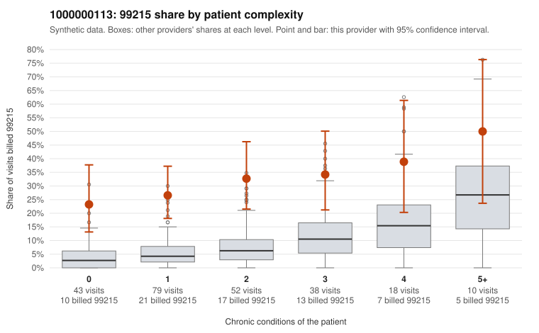

# 1000000113: 1000000113: too few returned records to judge

**Leaning (advisory):** Inconclusive

## Why

1000000113 billed 99215 on 30.4% of 240 claims against an expected 6.8% given patient complexity (risk-adjusted score 4.95; plain z-score vs peers 3.29). 42% of this provider's 99215 claims were on patients with 0 or 1 chronic conditions. Records came back for 30 claims. Of 10 documented 99215 claims, 5 (50%) were documented below the billed level, against 35% for the comparison providers. Note checks on 30 returned notes (share showing each sign): problems 30%, late 3%, unsigned 0%, data 10%. No audit trail was received. 4 of 23 notes claiming moderate-or-higher data reviewed had no lab or test line on the claim. The evidence does not support a call either way yet. Examples: C0050693: billed 99215; documented MDM level moderate, 38 minutes. C0050755: billed 99215; documented MDM level moderate, 30 minutes. C0050706: billed 99215, patient aged 45 with 1 chronic condition(s) (type 2 diabetes). C0050708: billed 99215, patient aged 42 with 0 chronic condition(s).

## Evidence chart

## Cited claims

`C0050693`, `C0050755`, `C0050706`, `C0050708`

## Suggested next steps

- 30 charts came back but do not settle it: request a targeted sample of 99215 charts, starting with C0050693, C0050755, C0050706.
- Re-check after the targeted charts arrive; do not call upcoding or a sicker panel on this evidence alone.

---
Citations checked: 4/4 valid. Synthetic data. The leaning is advisory; the flag comes from the statistical screen, and no clinical documentation is available beyond the sampled records-review facts shown in the packet.
