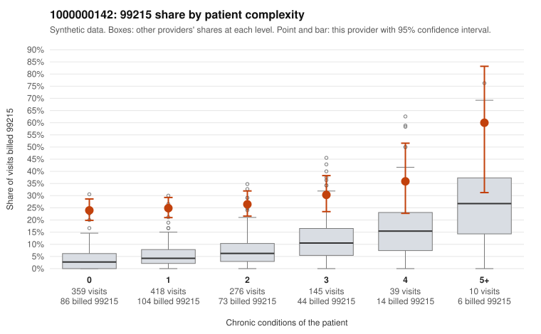

# 1000000142: 1000000142: too few returned records to judge

**Leaning (advisory):** Inconclusive

## Why

1000000142 billed 99215 on 26.2% of 1,247 claims against an expected 5.4% given patient complexity (risk-adjusted score 11.00; plain z-score vs peers 2.68). 58% of this provider's 99215 claims were on patients with 0 or 1 chronic conditions. Records came back for 30 claims. Of 11 documented 99215 claims, 0 (0%) were documented below the billed level, against 35% for the comparison providers. Note checks on 30 returned notes (share showing each sign): problems 30%, late 10%, unsigned 0%, data 17%. No audit trail was received. 7 of 24 notes claiming moderate-or-higher data reviewed had no lab or test line on the claim. The evidence does not support a call either way yet. Examples: C0063729: billed 99214, patient aged 73 with 3 chronic condition(s) (type 2 diabetes;obesity;osteoarthritis); documented MDM level low, minutes not recorded. C0062905: billed 99215, patient aged 18 with 1 chronic condition(s) (type 2 diabetes). C0063051: billed 99215, patient aged 37 with 0 chronic condition(s).

## Evidence chart

## Cited claims

`C0063729`, `C0062905`, `C0063051`

## Suggested next steps

- 30 charts came back but do not settle it: request a targeted sample of 99215 charts, starting with C0063729, C0062905, C0063051.
- Re-check after the targeted charts arrive; do not call upcoding or a sicker panel on this evidence alone.

---
Citations checked: 3/3 valid. Synthetic data. The leaning is advisory; the flag comes from the statistical screen, and no clinical documentation is available beyond the sampled records-review facts shown in the packet.
