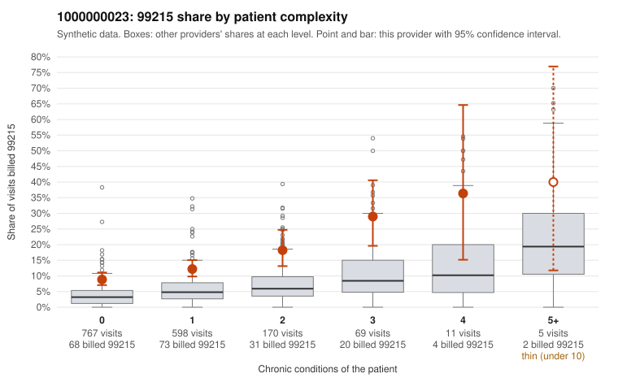

# 1000000023: 1000000023: too few returned records to judge

**Leaning (advisory):** Inconclusive

## Why

1000000023 billed 99215 on 12.2% of 1,620 claims against an expected 4.1% given patient complexity (risk-adjusted score 6.31; plain z-score vs peers 0.73). 71% of this provider's 99215 claims were on patients with 0 or 1 chronic conditions. Records came back for 0 claims. No documented 99215 claims came back. The evidence does not support a call either way yet. Examples: C0010153: billed 99215, patient aged 24 with 0 chronic condition(s). C0010228: billed 99215, patient aged 66 with 0 chronic condition(s).

## Evidence chart

## Cited claims

`C0010153`, `C0010228`

## Suggested next steps

- No usable charts yet: request a random sample of 30 charts, then a targeted sample of 99215s for C0010153, C0010228.
- If the practice does not respond, record that non-response is not evidence of upcoding and decide whether the claims signal alone warrants more.

---
Citations checked: 2/2 valid. Synthetic data. The leaning is advisory; the flag comes from the statistical screen, and no clinical documentation is available beyond the sampled records-review facts shown in the packet.
