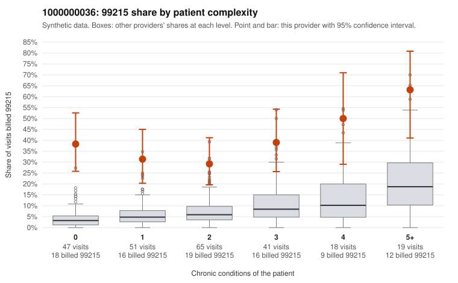

# 1000000036: 1000000036: 9 of 16 documented 99215 claims (56%) are documented below the billed level

**Leaning (advisory):** Pattern consistent with upcoding

## Why

1000000036 billed 99215 on 37.3% of 241 claims against an expected 6.8% given patient complexity (risk-adjusted score 7.30; plain z-score vs peers 4.61). 38% of this provider's 99215 claims were on patients with 0 or 1 chronic conditions. Records came back for 30 claims. Of 16 documented 99215 claims, 9 (56%) were documented below the billed level, against 24% for the comparison providers. Note checks on 30 returned notes (share showing each sign): problems 33%, late 3%, unsigned 0%, data 3%. No audit trail was received. 3 of 23 notes claiming moderate-or-higher data reviewed had no lab or test line on the claim. This pattern is consistent with upcoding. It is a reason to review the records, not a finding. Examples: C0018382: billed 99215; documented MDM level moderate, minutes not recorded. C0018483: billed 99215; documented MDM level moderate, 25 minutes. C0018513: billed 99215; documented MDM level moderate, minutes not recorded. C0018401: billed 99215, patient aged 56 with 1 chronic condition(s) (heart failure); documented MDM level high, 51 minutes. C0018415: billed 99215, patient aged 53 with 0 chronic condition(s). C0018422: billed 99215, patient aged 32 with 0 chronic condition(s).

## Evidence chart

## Cited claims

`C0018382`, `C0018483`, `C0018513`, `C0018401`, `C0018415`, `C0018422`

## Suggested next steps

- Request the full charts for C0018382, C0018483, C0018513 and have a certified coder re-score each against the current E/M rules (medical decision making or total time).
- If the re-scoring confirms the pattern, review the random sample in the recovery packet's sampling plan before any overpayment estimate; do not extrapolate from a targeted sample.
- Look at the notes themselves: 33% address fewer problems than their level implies and 3% were signed late; request the audit trail for C0018382, C0018483, C0018513.

---
Citations checked: 6/6 valid. Synthetic data. The leaning is advisory; the flag comes from the statistical screen, and no clinical documentation is available beyond the sampled records-review facts shown in the packet.
