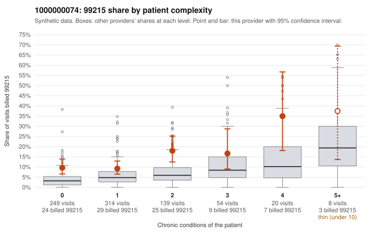

# 1000000074: 1000000074: too few returned records to judge

**Leaning (advisory):** Inconclusive

## Why

1000000074 billed 99215 on 12.4% of 784 claims against an expected 4.7% given patient complexity (risk-adjusted score 3.78; plain z-score vs peers 0.76). 55% of this provider's 99215 claims were on patients with 0 or 1 chronic conditions. Records came back for 30 claims. No documented 99215 claims came back. Note checks on 30 returned notes (share showing each sign): problems 33%, late 10%, unsigned 0%, data 3%. No audit trail was received. 1 of 19 notes claiming moderate-or-higher data reviewed had no lab or test line on the claim. The evidence does not support a call either way yet. Examples: C0041298: billed 99215, patient aged 71 with 1 chronic condition(s) (hypertension). C0041321: billed 99215, patient aged 41 with 1 chronic condition(s) (heart failure).

## Evidence chart

## Cited claims

`C0041298`, `C0041321`

## Suggested next steps

- 30 charts came back but do not settle it: request a targeted sample of 99215 charts, starting with C0041298, C0041321.
- Re-check after the targeted charts arrive; do not call upcoding or a sicker panel on this evidence alone.

---
Citations checked: 2/2 valid. Synthetic data. The leaning is advisory; the flag comes from the statistical screen, and no clinical documentation is available beyond the sampled records-review facts shown in the packet.
