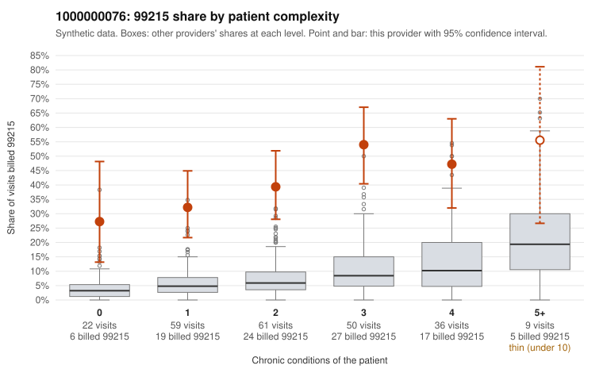

# 1000000076: 1000000076: too few returned records to judge

**Leaning (advisory):** Inconclusive

## Why

1000000076 billed 99215 on 41.3% of 237 claims against an expected 7.0% given patient complexity (risk-adjusted score 8.02; plain z-score vs peers 5.23). 26% of this provider's 99215 claims were on patients with 0 or 1 chronic conditions. Records came back for 45 claims. Of 28 documented 99215 claims, 9 (32%) were documented below the billed level, against 24% for the comparison providers. Note checks on 45 returned notes (share showing each sign): problems 20%, late 4%, unsigned 0%, data 2%. No audit trail was received. 1 of 40 notes claiming moderate-or-higher data reviewed had no lab or test line on the claim. The evidence does not support a call either way yet. Examples: C0042298: billed 99215; documented MDM level moderate, 39 minutes. C0042324: billed 99215; documented MDM level moderate, 34 minutes. C0042264: billed 99215, patient aged 61 with 1 chronic condition(s) (hypertension). C0042301: billed 99215, patient aged 45 with 1 chronic condition(s) (hypertension).

## Evidence chart

## Cited claims

`C0042298`, `C0042324`, `C0042264`, `C0042301`

## Suggested next steps

- 45 charts came back but do not settle it: request a targeted sample of 99215 charts, starting with C0042298, C0042324, C0042264.
- Re-check after the targeted charts arrive; do not call upcoding or a sicker panel on this evidence alone.

---
Citations checked: 4/4 valid. Synthetic data. The leaning is advisory; the flag comes from the statistical screen, and no clinical documentation is available beyond the sampled records-review facts shown in the packet.
