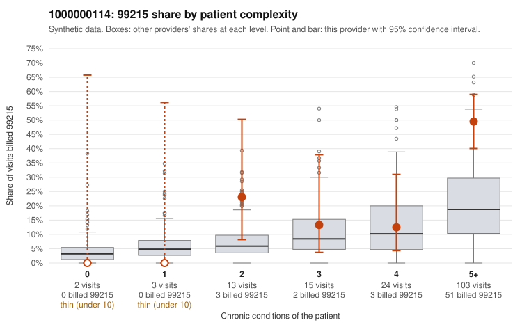

# 1000000114: 1000000114: too few returned records to judge

**Leaning (advisory):** Inconclusive

## Why

1000000114 billed 99215 on 36.9% of 160 claims against an expected 15.4% given patient complexity (risk-adjusted score 2.78; plain z-score vs peers 4.54). 0% of this provider's 99215 claims were on patients with 0 or 1 chronic conditions. Records came back for 0 claims. No documented 99215 claims came back. The evidence does not support a call either way yet. Examples: C0059206: billed 99215, patient aged 79 with 5 chronic condition(s) (hyperlipidemia;hypertension;atrial fibrillation;COPD;chronic kidney disease). C0059232: billed 99215, patient aged 69 with 5 chronic condition(s) (type 2 diabetes;obesity;hyperlipidemia;hypertension;atrial fibrillation). C0059200: billed 99214, patient aged 54 with 3 chronic condition(s) (hyperlipidemia;COPD;asthma). C0059255: billed 99214, patient aged 62 with 5 chronic condition(s) (hypothyroidism;obesity;hyperlipidemia;COPD;osteoarthritis).

## Evidence chart

## Cited claims

`C0059206`, `C0059232`, `C0059200`, `C0059255`

## Suggested next steps

- No usable charts yet: request a random sample of 30 charts, then a targeted sample of 99215s for C0059206, C0059232, C0059200.
- If the practice does not respond, record that non-response is not evidence of upcoding and decide whether the claims signal alone warrants more.

---
Citations checked: 4/4 valid. Synthetic data. The leaning is advisory; the flag comes from the statistical screen, and no clinical documentation is available beyond the sampled records-review facts shown in the packet.
