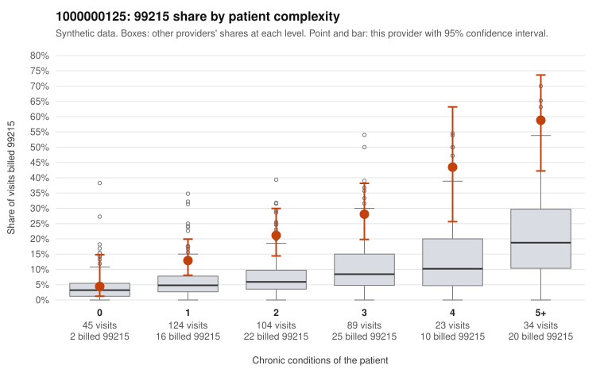

# 1000000125: 1000000125: too few returned records to judge

**Leaning (advisory):** Inconclusive

## Why

1000000125 billed 99215 on 22.7% of 419 claims against an expected 6.9% given patient complexity (risk-adjusted score 4.85; plain z-score vs peers 2.34). 19% of this provider's 99215 claims were on patients with 0 or 1 chronic conditions. Records came back for 30 claims. Of 6 documented 99215 claims, 1 (17%) were documented below the billed level, against 24% for the comparison providers. Note checks on 30 returned notes (share showing each sign): problems 17%, late 0%, unsigned 0%, data 7%. No audit trail was received. 4 of 17 notes claiming moderate-or-higher data reviewed had no lab or test line on the claim. The evidence does not support a call either way yet. Examples: C0062815: billed 99215; documented MDM level moderate, 27 minutes. C0062418: billed 99215, patient aged 69 with 1 chronic condition(s) (hypothyroidism); documented MDM level high, 45 minutes. C0062422: billed 99215, patient aged 40 with 1 chronic condition(s) (depression).

## Evidence chart

## Cited claims

`C0062815`, `C0062418`, `C0062422`

## Suggested next steps

- 30 charts came back but do not settle it: request a targeted sample of 99215 charts, starting with C0062815, C0062418, C0062422.
- Re-check after the targeted charts arrive; do not call upcoding or a sicker panel on this evidence alone.

---
Citations checked: 3/3 valid. Synthetic data. The leaning is advisory; the flag comes from the statistical screen, and no clinical documentation is available beyond the sampled records-review facts shown in the packet.
