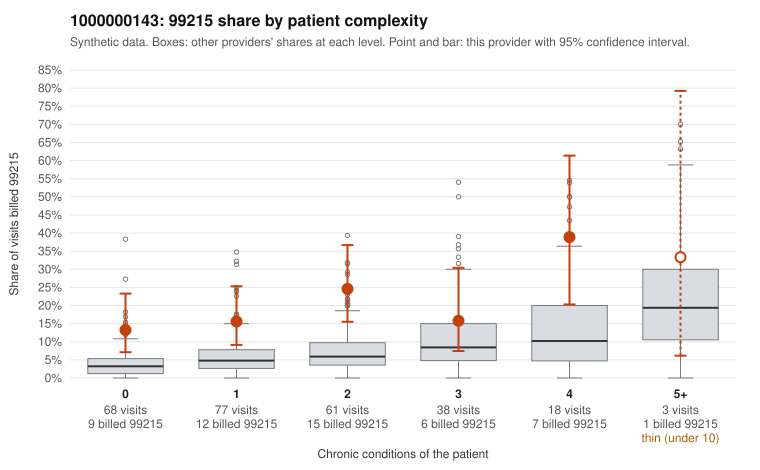

# 1000000143: 1000000143: too few returned records to judge

**Leaning (advisory):** Inconclusive

## Why

1000000143 billed 99215 on 18.9% of 265 claims against an expected 5.5% given patient complexity (risk-adjusted score 3.58; plain z-score vs peers 1.76). 42% of this provider's 99215 claims were on patients with 0 or 1 chronic conditions. Records came back for 45 claims. Of 20 documented 99215 claims, 2 (10%) were documented below the billed level, against 24% for the comparison providers. Note checks on 45 returned notes (share showing each sign): problems 22%, late 2%, unsigned 0%, data 9%. No audit trail was received. 4 of 38 notes claiming moderate-or-higher data reviewed had no lab or test line on the claim. The evidence does not support a call either way yet. Examples: C0074435: billed 99215; documented MDM level moderate, minutes not recorded. C0074479: billed 99215, patient aged 67 with 4 chronic condition(s) (hyperlipidemia;hypertension;COPD;asthma); documented MDM level low, minutes not recorded. C0074334: billed 99215, patient aged 34 with 0 chronic condition(s). C0074380: billed 99215, patient aged 48 with 1 chronic condition(s) (obesity).

## Evidence chart

## Cited claims

`C0074435`, `C0074479`, `C0074334`, `C0074380`

## Suggested next steps

- 45 charts came back but do not settle it: request a targeted sample of 99215 charts, starting with C0074435, C0074479, C0074334.
- Re-check after the targeted charts arrive; do not call upcoding or a sicker panel on this evidence alone.

---
Citations checked: 4/4 valid. Synthetic data. The leaning is advisory; the flag comes from the statistical screen, and no clinical documentation is available beyond the sampled records-review facts shown in the packet.
