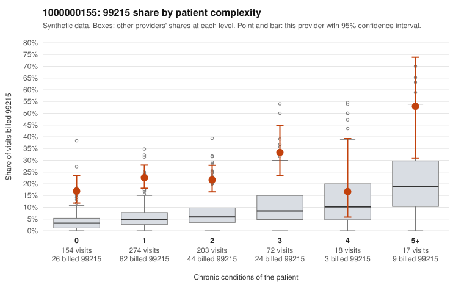

# 1000000155: 1000000155: 0 of 19 documented 99214 and 99215 claims (0%) are documented below the billed level

**Leaning (advisory):** Pattern consistent with upcoding

## Why

1000000155 billed 99215 on 22.8% of 738 claims against an expected 5.3% given patient complexity (risk-adjusted score 8.15; plain z-score vs peers 2.36). 52% of this provider's 99215 claims were on patients with 0 or 1 chronic conditions. Records came back for 30 claims. Of 4 documented 99215 claims, 0 (0%) were documented below the billed level, against 24% for the comparison providers. Note checks on 30 returned notes (share showing each sign): problems 33%, late 13%, unsigned 0%, data 7%, bulk created 3%, paste heavy 7%. 3 of 19 notes claiming moderate-or-higher data reviewed had no lab or test line on the claim. This pattern is consistent with upcoding. It is a reason to review the records, not a finding. Examples: C0078724: billed 99215, patient aged 60 with 1 chronic condition(s) (COPD). C0078740: billed 99215, patient aged 41 with 0 chronic condition(s). C0078743: billed 99215, patient aged 53 with 1 chronic condition(s) (hypertension).

## Evidence chart

## Cited claims

`C0078724`, `C0078740`, `C0078743`

## Suggested next steps

- Request the full charts for C0078724, C0078740, C0078743 and have a certified coder re-score each against the current E/M rules (medical decision making or total time).
- If the re-scoring confirms the pattern, review the random sample in the recovery packet's sampling plan before any overpayment estimate; do not extrapolate from a targeted sample.
- Look at the notes themselves: 33% address fewer problems than their level implies and 13% were signed late; request the audit trail for C0078724, C0078740, C0078743.

---
Citations checked: 3/3 valid. Synthetic data. The leaning is advisory; the flag comes from the statistical screen, and no clinical documentation is available beyond the sampled records-review facts shown in the packet.
