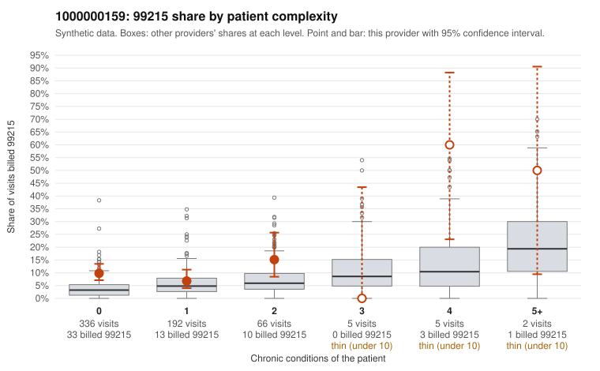

# 1000000159: 1000000159: 10 of 20 documented 99215 claims (50%) are documented below the billed level

**Leaning (advisory):** Pattern consistent with upcoding

## Why

1000000159 billed 99215 on 9.9% of 606 claims against an expected 3.9% given patient complexity (risk-adjusted score 2.83; plain z-score vs peers 0.37). 77% of this provider's 99215 claims were on patients with 0 or 1 chronic conditions. Records came back for 45 claims. Of 20 documented 99215 claims, 10 (50%) were documented below the billed level, against 24% for the comparison providers. Note checks on 45 returned notes (share showing each sign): problems 58%, late 7%, unsigned 0%, data 4%, bulk created 0%, paste heavy 0%. 3 of 36 notes claiming moderate-or-higher data reviewed had no lab or test line on the claim. This pattern is consistent with upcoding. It is a reason to review the records, not a finding. Examples: C0080995: billed 99215, patient aged 58 with 0 chronic condition(s); documented MDM level moderate, minutes not recorded. C0081010: billed 99215; documented MDM level moderate, 34 minutes. C0081101: billed 99215; documented MDM level moderate, 31 minutes. C0080999: billed 99215, patient aged 51 with 1 chronic condition(s) (obesity). C0081004: billed 99215, patient aged 60 with 1 chronic condition(s) (hypertension).

## Evidence chart

## Cited claims

`C0080995`, `C0081010`, `C0081101`, `C0080999`, `C0081004`

## Suggested next steps

- Request the full charts for C0080995, C0081010, C0081101 and have a certified coder re-score each against the current E/M rules (medical decision making or total time).
- If the re-scoring confirms the pattern, review the random sample in the recovery packet's sampling plan before any overpayment estimate; do not extrapolate from a targeted sample.
- Look at the notes themselves: 58% address fewer problems than their level implies and 7% were signed late; request the audit trail for C0080995, C0081010, C0081101.

---
Citations checked: 5/5 valid. Synthetic data. The leaning is advisory; the flag comes from the statistical screen, and no clinical documentation is available beyond the sampled records-review facts shown in the packet.
